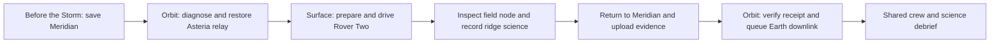

# Mission Control Jr. — One Mission, Two Frontiers

Design and implementation plan · 20 October 2026

**Implementation update:** the user's subsequent arrival-game brief changes the first playable chapter to Jin's Sol 11 arrival, docking, station operations, lander preparation and descent. That chapter is now implemented at `/orbit.html`; use `ORBITAL-WALKTHROUGH.md` for the current route and controls. The Maya relay/science handoff and EVA flow below remain a future expansion concept rather than the current chapter's story. The existing surface missions remain playable and linked.

## Scope and current status

Extend the existing Three.js/Vite project, its characters, recorded dialogue system, first/third-person cameras, and Mission 2 state machine. Retain Mission 1: Before the Storm and Mission 2: Tracks in the Dust. The thirty-sol resource campaign remains a separate mode.

Implemented now: remove the enlarged Olympus Mons mesh, presentation base, sign, map symbol, walking/vehicle collision boundary, and camera obstruction from Mission 2. Preserve the original asset and its credited optional archive display. The existing small Mars globe and robotic rover exhibit remain. All 71 existing tests pass; the production build succeeds with the existing shared-loader chunk-size advisory.

The larger relay/science/EVA chapter described below remains planned. A playable arrival chapter now supplies the orbital/station foundation, with a complete objective-driven mission and a cinematic transition into the existing surface game.

## Research and the design decisions it supports

These are primary NASA/JPL references reviewed before making this plan. The game mechanics are our educational adaptations; these sources do not validate the fictional station or certify this game as astronaut training.

| Reference | Relevant evidence | Game design consequence |
| --- | --- | --- |
| [NASA analog missions](https://www.nasa.gov/analog-missions/) and [CHAPEA](https://www.nasa.gov/humans-in-space/chapea/about-chapea/) | Analog work explores crew operations, limited resources, maintenance, science, and equipment faults. | Give each task an operational reason, a resource consequence, and a safe return option. Use briefing → preparation → execution → debrief. |
| [NASA Johnson simulation and modeling](https://www.nasa.gov/reference/jsc-simulation-modeling/) | NASA uses mission-specific scenes and integrated human-in-the-loop EVA and robotics simulations. | Require the player to use physical equipment and verify results. Short station procedures teach control and observation instead of only clicking dialogue. |
| [NASA Neutral Buoyancy Laboratory](https://www.nasa.gov/johnson/neutral-buoyancy-laboratory/) | Spacewalk training is a distinct operational training activity. | Make external maintenance a rehearsed sequence with equipment checks, a buddy, handrails, tether attachment, and an abort path. The simplified sequence is not a real flight procedure. |
| [JPL surface software and rover navigation](https://robotics.jpl.nasa.gov/what-we-do/flight-projects/mars-science-laboratory/surface-system-software-and-rover-navigation/) | Planners assess terrain; navigation uses waypoints, hazard avoidance, and visual odometry to detect motion/slip. | Keep manual crew-rover driving, parked observations, a reasoned detour, wheel inspection, and reserve forecasts. Use the robotic exhibit to explain how robotic driving differs. |
| [NASA Mars Relay Network](https://science.nasa.gov/mars/mars-relay-network/) | Orbiters relay surface data, and contact opportunities vary. | Connect orbit and surface through queued records, a relay pass, acknowledgements, and a science handoff. A moving station is not permanently overhead. |
| [NASA Mars communication disruption and delay](https://www.nasa.gov/wp-content/uploads/2024/01/mars-communications-disruption-and-delay.pdf) | Earth–Mars signal delays persist even with relay assets. | Separate local station/surface radio from delayed Earth messages. Do not make Earth answer emergencies instantly. Compress waiting for the demo and label it clearly. |

## Recommended story

**Working title: Signal Across the Dust.** Meridian survived the storm in Mission 1. On Sol 16, its crew needs to check a field weather/data node near Kestrel Ridge and return a documented geological observation. Their orbital support station, **Asteria**, has a failed antenna pointing-drive circuit. Its habitable systems remain stable, but the next surface-data pass is at risk.

The player first takes the role of **Maya Chen, station systems operator**, then switches to the existing **Jin Park**, driving with **Amara Okafor** under Elena's surface command. Clearly label place, role, and Sol at each switch. Maya stays in orbit; Jin stays on Mars. This connects the missions without inventing an instantaneous ascent, landing, or extra four-person surface crew member.

Asteria is an original fictional future Mars station. It is not the ISS, an existing NASA installation, or a claim about an approved NASA Mars architecture.

## Orbital chapter — Asteria: Restore the Link

Target full play time: 6–8 minutes. A guided challenge-demo path can take about 90 seconds; it must be labeled guided and must not award unearned campaign completion.

1. **See Mars from space.** Open with a skippable exterior view: a recognizable sunlit Mars, dark hemisphere, restrained atmospheric limb, and Asteria moving around it. Drag to orbit the overview camera; wheel and +/− zoom; select Meridian to show the surface target. Then choose “Enter station.” Make it interactive rather than a video backdrop.
2. **Receive Elena's handoff.** At the window/relay console, see Meridian and the queued expedition request. Explain the objective in one sentence: “Restore the relay so Jin and Amara can return their field record.” Show station power, link status, and the next pass only when relevant.
3. **Diagnose before repairing.** Compare pointing-drive current, antenna position, and power-bus readouts. Identify the stalled pointing-drive branch. Isolate that branch and verify it is unpowered. Protect life-support power: shutting down the entire station is rejected with an explanation. These are authored educational values, not spacecraft specifications.
4. **Prepare for external work.** At the airlock: confirm buddy/readiness, secure the tool, inspect suit reserves, attach tether, and follow the hatch/pressure sequence. Interlocks prevent opening both hatches or entering an unsafe pressure state. A companion remains in radio contact.
5. **Perform a short tethered maintenance task.** Follow a constrained handrail route to the service bay. Use the manual antenna mount while the failed drive is isolated. Align the dish with a visible local surface-link target using small controlled adjustments; confirm signal strength and stability. The action physically changes the antenna and telemetry. No free orbital flight is needed for the first prototype.
6. **Return and verify.** Retrace the tether/handrail route, secure tools, complete airlock return, and test the relay from the console. Send a local readiness packet; receive Meridian's acknowledgement. Save checkpoint and switch to Jin on the surface.

Recovery: a failed alignment keeps the objective active; low suit margin prompts safe return; abort stores progress and explains the missed opportunity. No random catastrophic failure or jump scare. An inaccessible hardware fault should not masquerade as a player error.

## Surface chapter — Tracks in the Dust: Ground Truth

Keep the implemented eight-stage mission and its physical action gates. Add only the connective work that serves the story:

1. Brief with Elena: show the orbital support status and the field-node/science objective. Reuse the landing screen and existing dialogue roles.
2. Collect R2, fit it, inspect/repair the pin and camera, verify suits/radio, and perform the actual drive/steer/stop test. Boarding always gives explicit brake and next-action guidance.
3. At the terminal compare routes, inspect the orbital overview, and log a route reason. Orbital imagery identifies broad terrain; it cannot guarantee the local crust is safe.
4. Drive manually through the two report stations. Stop, park, and record conditions. At the second station compare the field node's weather reading with the orbital forecast, documenting uncertainty rather than declaring one reading proof of a storm.
5. Inspect uncertain soil from firm ground and select the deliberate detour or return. The relay status never removes terrain hazards or return-reserve requirements.
6. At Kestrel Ridge, retain the existing context photo, close photo with scale, observation-based description, and optional sample decision. Add a small calibration/weather node beside the safe field parking area, with its own short proximity interaction.
7. Return to Meridian. Park, exit, transfer photographs and node data, and confirm both crew. Do not add an obligatory remote upload while driving.
8. Switch back to Maya for a brief orbital epilogue: verify packet completeness, acknowledge the surface team, prioritize crew health/weather before large imagery, and queue the Earth downlink. End with the shared record and a debrief about decisions and evidence.

The same packet ID and player-created photograph thumbnails must appear at the surface terminal and orbital console. This makes the connection visible. Crew radio is local; Earth messages are visibly delayed. Surface work remains playable offline: if a contact pass is missed, retain the record and use the next pass. Never erase valid science or trap the player in an endless countdown.

## Environment and art direction

**Surface:** retain the established ochre ground, blue-grey equipment, warm sunlight, and muted teal UI. No enlarged tabletop terrain, rectangular cliffs, or unrelated landmark blocking a route. Keep distant landforms low and integrated with the ground. Use instanced stones, shallow terrain relief, dust restrained to the distance, and functional props positioned outside driving corridors. Add a weather mast, calibration panel, numbered sample trays, and a surface relay dish only where the mission uses them.

**Orbit:** black space, one clear sun direction, pale station hull, dark radiators, blue-black solar cells, and a restrained orange antenna/service highlight. Use the supplied textured Mars sphere first. Show the planet prominently in the opening and through a large observation window. Avoid a dense starfield on the bright day side, ground fog in space, an Earth-blue atmosphere, or making a dust storm visibly shake the orbital station.

**Station layout:** one central node joins an observation/communications module, a short habitat/work module, a two-hatch airlock, and one docking collar. Outside: compact truss, two solar wings, radiator plates, a steerable dish, a clearly marked service box, handrails, and tether anchors. Every reachable room or prop supports navigation, a task, or crew context. Keep the initial playable interior small enough to learn without a map overlay.

**Movement:** retain first/third person on Mars. Station interior uses assisted microgravity translation with damping, clear handholds, collision bounds, and no forced camera roll. EVA uses anchor-to-anchor handrail movement with a visible tether; arbitrary six-axis free flight is a later extension. Station and astronaut share orbital motion, so the station does not sweep past its own crew.

**UI/audio:** one current objective and one contextual interaction; Tasks, Map, Help, and journal remain optional. Zoom is available in all exploration cameras, clamped to prevent clipping. Teach only the control needed now. Use one cancellable voice queue across chapter switches; never fall back to the old browser voice. Add soft equipment hum inside and suit/radio sounds outside. Do not play an atmospheric wind sound in vacuum. Captions, reduced motion, mute, pause, and objective replay remain available.

## Asset decisions

| Artifact | Decision | Use and constraints |
| --- | --- | --- |
| Supplied `mars.glb` / optimized `reference-mars-globe.glb` | Reuse first | Orbital planet and navigation globe; normalize bounds, preserve Akshat's credit. The existing 1024-pixel map suits the first prototype, not close scientific terrain inspection. |
| `reference-olympus-mons.glb` | Archive only | Remove from surface, retain labeled optional geographic reference. Its presentation plinth and illustrative scale make it unsuitable as nearby ground. |
| Existing crewed Rover Two and animated astronaut | Reuse | Jin/Amara, vehicle controls, suit shell. Add floating/handrail poses procedurally where needed; do not replace crewed physics with a robotic rover mesh. |
| Supplied concept rover and Perseverance | Reuse | Existing reachable east equipment pad; switch one at a time. Use a simple instrument comparison interaction. Heavy Perseverance remains loaded on demand. |
| Habitat, solar array, terminal, battery, outcrop, camera/scale/sample | Reuse | Existing surface readiness and science loop. Reuse material conventions on station equipment rather than reusing surface dust textures on station walls. |
| Asteria exterior and small interior | Create procedurally | Cylinder modules, hatches, truss, solar panels, radiators, docking ring, window frame, equipment racks. Export self-contained GLB if needed, retaining separate named interactive parts. |
| Relay dish, service box, handrails, tether anchors | Create procedurally | Animate a named dish pivot, isolate-circuit indicator, and service-cover latch. Tether is a short runtime curve. |
| Weather mast, calibration target, sample tray | Create procedurally | Useful surface evidence props with simple collision bounds and proximity interactions. |
| Starfield, thin atmospheric limb, contact/pass arc | Runtime geometry/shaders | Shared point geometry, restrained limb effect, and optional orbit lines; no extra texture downloads required. |

**Required downloads: none for the first connected prototype.** Avoid large generic station packs; their layouts rarely match the intended tasks and often cost more integration work than simple custom geometry.

Optional quality upgrade, if the existing planet is insufficient: download **“Planet Mars, 3D Model” → “glTF File (3D Model)”** from [NASA Science's exact resource page](https://science.nasa.gov/resource/planet-mars-3d-model/) (listed as 3.85 MB when reviewed). Put the complete unpacked model and its texture/buffer files in `assets/reference/nasa-mars/`; do not move only the `.gltf` and break its references. Use it for the orbital planet after inspecting appearance, attribution, axes, and performance; retain the supplied globe if the upgrade is not visibly better. Record NASA/JPL-Caltech credit and the resource page. No station download is needed. The already supplied Perseverance does not need to be downloaded again.

## Implementation sequence and file boundaries

1. **Surface cleanup — completed.** Remove mountain placement, sign, minimap symbol, and all matching collision/camera references; retain archive and provenance. Verify original route tests and build.
2. **Shared campaign contract.** Add `campaign-progress.js` with versioned optional local storage, chapter checkpoints, role/location, relay readiness, surface outcome, field packet, and upload status. Preserve the existing `SAVE_KEY` mission result; migrate without deleting older progress. Keep the thirty-sol mode independent. A direct Mission 2 launch receives a clearly labeled standalone briefing and a cached relay slot.
3. **Orbital view and station shell.** Add `orbit.html`, `orbit-demo.js`, `orbit.css`, `orbital-environment.js`, and `station-model.js`; add the entry to the existing Vite multipage build. Reuse Three.js, asset loaders, visual branding, input conventions, and responsive HUD structure. Deliver a Mars overview, external station camera, zoom, observation window, and reachable console before adding procedures.
4. **Orbital gameplay state.** Add pure `orbital-mission.js` for diagnosis, branch isolation, EVA readiness, airlock transitions, antenna alignment, return verification, and handoff. Add a separate `orbital-player.js` for microgravity/handrail controls rather than changing the surface walk controller's gravity assumptions. Use named primitive colliders and a task source of truth.
5. **Cross-chapter integration.** Link Mission 1 debrief → orbital prologue → Mission 2 → orbital epilogue. Add the field-node interaction without skipping existing route/science gates. Serialize the actual science record and receipt; transfer only after the existing surface terminal action. Chapter transitions dispose scene resources and cancel active voice/queued subtitles before loading the next chapter.
6. **Story, feedback, and recovery.** Write short Maya/Elena/Jin/Amara exchanges; use captions and existing clean audio architecture. Record new voice only after text and interactions settle. Add explicit acknowledgement, delayed Earth queue, safe EVA abort, missed-pass recovery, checkpoints, restart, and standalone launch behavior.
7. **Verify and package.** Validate any generated GLBs, test gates and persistence, manually play the connected route and abort/retry, measure frame time, check small screens and both cameras, build all entry points, update walkthrough/credits, and rebuild the downloadable game ZIP.

## Technical and realism constraints

Use separate orbital and surface scenes with one active renderer; do not load both detailed environments at once. Keep the local station simulation in meters near the origin. Draw the planet as a distant backdrop with consistent angular size and camera-relative transforms, or use a separate background pass. A far-away planet must not intersect the station or inflate near/far planes until suit-depth precision fails. The overview may use a labeled illustrative scale while the station scene retains local scale.

Use a deterministic circular-orbit approximation for visualization and contact timing; compress time for the demo and state that it is illustrative. Do not market it as navigation-grade astrodynamics. Derive line-of-sight/contact from station position and the rotating surface target, with a generous authored training window. Mars must occlude signals when it blocks the path. Earth latency is a separate queue, not the local pass timer.

Target a new station scene below roughly 100k visible triangles and 80 draws before shadows; these are budgets to measure, not current achieved performance. Share geometry/materials, instance repeated rails and panels, limit shadows, cap device-pixel ratio, and avoid bloom-heavy postprocessing. Keep the expensive reference rover out of the orbital bundle. Dispose render targets, listeners, audio, and textures at transitions.

Data messages must be idempotent: retrying an upload cannot award duplicate science. Save plain records and image references rather than Three.js objects. Cap photo data and handle full/unavailable browser storage without blocking the debrief. Menus pause authored operational timers. Critical prerequisites live in pure mission state, not only disabled buttons.

## Completion criteria

- No mountain/plinth, matching map icon, sign, or invisible collision remains in the surface scene.
- The player clearly sees and can zoom around Mars from space, identify Asteria, and enter the station.
- Station diagnosis requires interpreting telemetry; external work requires readiness, tether, and valid airlock state; alignment changes the actual antenna and local link readout.
- Walking, microgravity controls, handrail movement, zoom clamps, wall avoidance, and first/third-person switching work without forced roll or hidden input conflicts.
- Mission 2 still requires physical readiness, real driving, two parked reports, terrain reasoning, science, return, transfer, and crew count.
- The orbital console displays the surface player's actual record. Incomplete/aborted science produces an honest corresponding epilogue, not fabricated findings.
- Save/reload, direct launch, unavailable storage, low reserves, missed pass, abort/retry, and repeated upload all have tested outcomes.
- Only one voice speaks at a time, including immediately after transitions; captions match it.
- Core controls/objective remain readable at desktop and narrow widths without covering the center of the scene.
- Existing tests and production build pass, new orbital/persistence tests cover real failure gates, and a complete browser walkthrough confirms behavior and resource cleanup.

## Challenge demonstration

Use a 3–4 minute guided presentation: 20 seconds of the interactive Mars/station overview, 45 seconds of diagnosis and a short tethered alignment, 90 seconds showing the existing rover preparation/traverse/field evidence, and 30 seconds showing the shared receipt and debrief. Use an explicitly labeled chapter selector/checkpoint to reach representative moments during the presentation. Preserve a separate complete playable route; do not fake completion to make the demo fit.

Learning evidence in the debrief: safe preparation, communication clarity, terrain reasoning, distinction between observation and inference, protected return margins, and verified data delivery. Reward a justified safe abort; never grade a dangerous shortcut above safe crew return.
