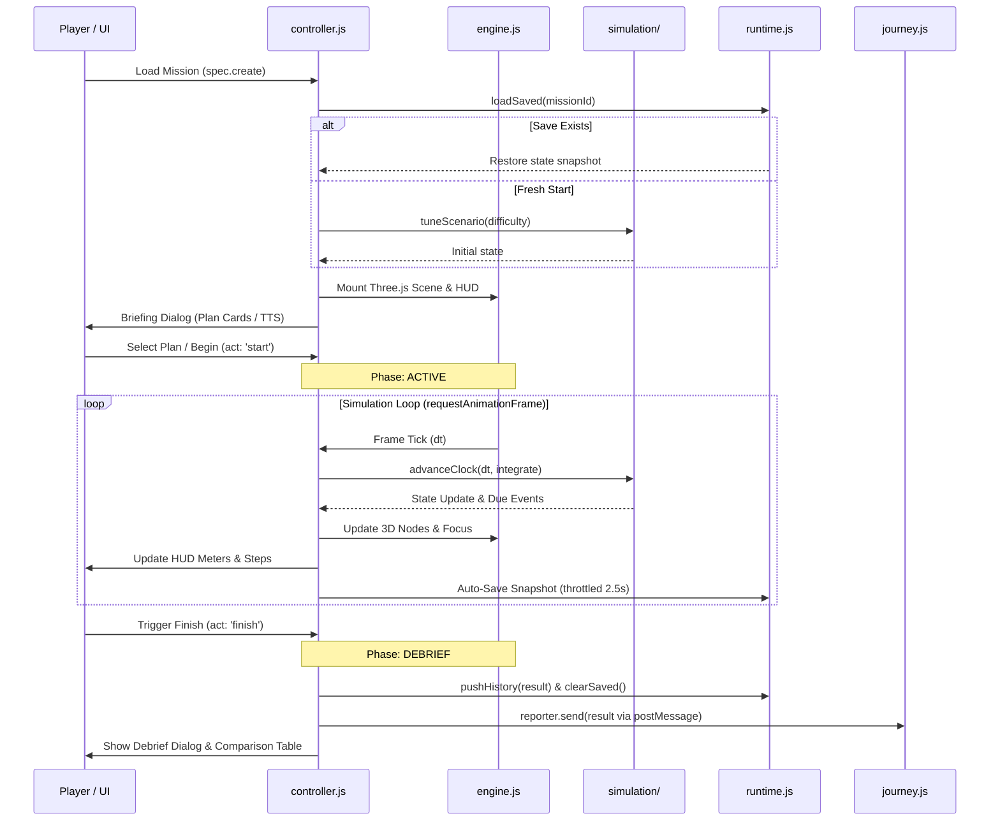
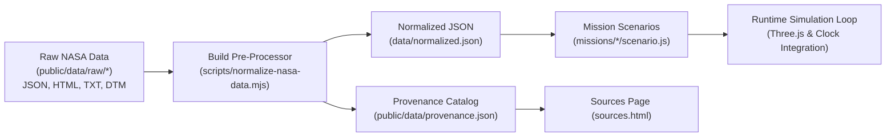

# Deliverable A: Existing Game Audit
**Mission Control Jr. — Junior Astronaut Mission Trainer**  
**Audit Date:** November 2026  
**Auditor:** Codebase & Science Audit Specialist  

---

## Executive Summary

Mission Control Jr. is a static web-based 3D educational space simulation built for learners aged 7–12. Running on Vite 8.3.4, Three.js v0.186.1, and pure ES modules, it simulates human spaceflight operations across Mars, the Moon, and training environments without requiring backend servers, user accounts, or proprietary external services.

The codebase comprises **11 distinct playable missions and simulation modules**:
1. **Mars 01: Arrival at Mars (`orbit`)** — Orbital power management, radio repair, and landing site selection with TRN hazard diversion.
2. **Mars 02: Before the Storm (`storm`)** — EVA dust storm preparation, solar array brushing, rover battery recovery, grid repair, and shelter-in-place airlock sealing.
3. **Mars 03: Tracks in the Dust (`rover`)** — Rover pre-drive inspection, Jezero Crater traverse navigation over real HiRISE topography, regolith hazard avoidance, and geological photography.
4. **Mars 04: A Place to Hide (`solar-shelter`)** — Space weather alert response, materials budgeting, water wall and polyethylene shield assembly, and multi-crew solid-angle radiation sheltering.
5. **Mars 05: The Greenhouse Promise (`greenhouse`)** — Controlled Environment Agriculture (CEA), 16:8 photoperiod regulation, Veggie fan telemetry anomaly troubleshooting, plumbing repair, and harvesting.
6. **Mars 06: Message to Earth (`earth-delay`)** — Speed-of-light communication latency (11.2 min one-way), life support water recycler diagnostics, multimeter circuit testing, and crew autonomy vs ground control.
7. **Moon 01: Chasing the Sun (`lunar-sunlight`)** — Lunar South Pole low-angle solar dynamics, telescoping vertical solar mast deployment, sun-tracking, and 18-day crater shadow power simulation.
8. **Moon 02: Dust Busters (`lunar-dust`)** — Lunar regolith mitigation, airlock ingress protocols, Electrodynamic Dust Shield (EDS) electrostatic cleaning, vacuuming, and scrubber filter saturation.
9. **Moon 03: Over the Hill (`lunar-relay`)** — Line-of-sight RF communications obstruction over crater rims, deployable lunar relay mast setup, Earth-Moon light time (1.28s), and cold-trap regolith core drilling.
10. **Training: Be the Base Boss (`base-boss` / `extended`)** — 6-outpost regional Jezero logistics network, real-time rover driving and tethered EVA, and 3-shift crisis decision drills.
11. **Survival: Thirty Sols at Meridian (`thirty-sols` / `campaign`)** — 30-sol daily crew assignment, life support consumable balances, unexpected event branching, and cumulative morale/health management.

The test suite contains **241 automated tests** running in Node.js's native test runner (`node --test`), all passing in ~3.6 seconds.

---

## Part 1: Comprehensive Audit of All 11 Missions

---

### 1. Mars 01: Arrival at Mars (`orbit`)

- **Route / URL & Entry File:**
  - Route: `/orbit` or `index.html?mission=orbit`
  - Entry File: `missions/orbit/entry.js` (orchestrates `missions/orbit/scenario.js`, `state.js`, `actions.js`, `scene.js`, `approach-state.js`, `station-layout.js`, and `landing-cockpit.js`). Standalone HTML: `orbit.html`.
- **What the Player Actually Does:**
  1. *Station Locomotion & Inspection*: Floats/walks through the 3D Asteria orbital station deck using WASD or station waypoint HUD buttons (Power Panel, Radio Rack, Spares Locker, Planner Table, Lander Hatch, Mars Window).
  2. *Electrical Load Shedding*: Manages electrical loads (`life`, `heat`, `radio`, `amp`, `motor`, `charger`, `camera`) against sunlight generation (10 units) and eclipse shadow capacity (6 units). Life support (3 units) is locked ON. Turning on excessive loads trips the main breaker handle, requiring a manual reset click.
  3. *Radio Circuit Diagnosis & Repair*: Tests the communications link. Identifies a randomized seeded fault:
     - `feed`: Loose antenna cable connector $\rightarrow$ must push and twist tight.
     - `amp`: Burnt-out amplifier $\rightarrow$ must fetch spare from locker and swap in.
     - `card`: Stuck controller card $\rightarrow$ must pull and reseat.
     - *Safety Rule*: Must switch off the target subsystem's circuit breaker before touching it; servicing a live circuit delivers an electrical zap and trips the breaker.
  4. *Lander Charging*: Turns off non-essential loads (radio/amp) to supply 3 units to the lander battery during sunlight. Charges lander to $\ge 80\%$, arming the Terrain-Relative Navigation (TRN) Hazard Avoidance Camera (`hazardCamReady`).
  5. *Landing Site Selection*: Evaluates 3 landing sites at the Planner Table:
     - *Meridian Pad* (0.3 km away, 28% safe ground, surrounded by boulders).
     - *Dune Ridge* (2.5 km away, 50% safe ground, sand dunes and slopes).
     - *Wide Plains* (9.0 km away, 100% safe ground, flat plains, long rover drive).
  6. *Descent*: Boards lander through the hatch. Lander undocks during the next orbital pass over Meridian Base and runs a descent sequence to touchdown.
- **Scientific Concepts Taught:**
  - Orbital mechanics & orbital period (120-minute orbit with a 35-minute planetary shadow eclipse).
  - Spacecraft power management: Photovoltaic solar array generation in direct sunlight vs battery discharge in shadow.
  - High-voltage electrical safety protocols (de-energizing circuits before servicing).
  - Satellite communications relays supporting Martian surface operations.
  - Landing ellipses and targeting dispersion ellipses.
  - Terrain-Relative Navigation (TRN) and autonomous hazard detection/diversion (as flown on Mars 2020 Perseverance).
- **Current Scoring / Progression Mechanics:**
  - Score (0–100): `(rough ? 35 : 65) + (comms ? 15 : 0) + (distanceKm < 1.5 ? 10 : distanceKm < 4 ? 5 : 0) + (coldMinutes ? 0 : 5) + (zaps ? 0 : 5) - passIndex * 5`.
  - Outcomes: `landed-smooth` (safe touchdown in designated zone), `landed-diverted` (hazard camera autonomous diversion away from rocks), `landed-rough` (touchdown on rocks without hazard camera), `stopped`.
  - Mastered condition: `success && comms && !zaps && !coldMinutes`.
- **Real Data Currently Used:**
  - Perseverance Mars 2020 Terrain-Relative Navigation (TRN) flight heritage.
  - MRO (Mars Reconnaissance Orbiter) relay operational architecture.
  - Authored values: 120-min orbit, power units (10 sun / 6 shadow), 6 km landing ellipse, 0.45 beacon shrink factor.
- **What is Scientifically Accurate:**
  - Spacecraft in low Mars orbit experience periodic thermal and power blackouts when entering Mars' shadow.
  - Solar arrays do not generate power during eclipse; batteries must sustain critical life support and survival heaters.
  - Touching energized circuitry without lockout/tagout creates short circuits and safety hazards.
  - Radio beacons reduce landing uncertainty; autonomous optical hazard cameras detect boulders and divert touch down.
- **What is Missing or Scientifically Inaccurate:**
  - The 120-minute orbit is circularized and very low; real MRO orbit is sun-synchronous with a ~112-minute period.
  - Power units are abstract integers (1–10) rather than real watts/amperes.
  - Spacecraft microgravity interior allows the player to walk on floors like a terrestrial room rather than realistic 6-DOF zero-g tethering.
- **Specific Components That Can Be Reused:**
  - `missions/orbit/station-layout.js`: 3D station interior coordinate map, collision bounding boxes, and interactive stations.
  - `missions/orbit/approach-state.js` & `landing-cockpit.js`: 3D HUD instrumentation, cockpit dashboard overlays, and docking math.
  - `orbital-audio.js`: Synthesized Web Audio soundscapes (harmonic hum, docking latch, airlock hiss, electrical buzz).

---

### 2. Mars 02: Before the Storm (`storm`)

- **Route / URL & Entry File:**
  - Route: `/storm` or `index.html?mission=storm`
  - Entry File: `storm.html` referencing `demo.js`, `mission.js`, and `outpost.js`.
- **What the Player Actually Does:**
  1. *Countdown Pressure*: Player controls EVA engineer Jin Park outside Meridian Base. A global Martian dust storm arrives in 360 seconds (6 minutes).
  2. *Computer Diagnosis*: Walks to the base computer terminal to diagnose dusty solar panels and depleted backup batteries.
  3. *Solar Panel Scrubbing*: Walks to 3 photovoltaic arrays; holds interaction key to scrub accumulated dust off each array with an EVA brush (+13% power per panel).
  4. *Rover Battery Salvage*: Walks to the parked exploration rover, unlatches the rear cargo hatch, and retrieves a heavy spare battery.
  5. *Power Box Overhaul*: Carries the battery to the main exterior electrical junction box, slots it into the housing, turns 3 rotary connectors to positions 1, 2, and 3, and engages the main circuit breaker (+25% power).
  6. *Strategic Power Allocation*: Returns to the computer terminal to make a critical operational choice:
     - `life`: Diverts power to oxygen generators and environmental life support ($O_2 = 95\%$, Morale = $84\%$).
     - `research`: Diverts power to Amara's long-term agricultural experiment ($O_2 = 55\%$, Morale = $75\%$, science preserved).
  7. *Airlock Ingress & Sealing*: Rushes inside the habitat airlock before the storm strikes. At the inner console, seals the airlock hatch, waits 5 seconds for the storm to pass, and sends a radio transmission to Earth.
- **Scientific Concepts Taught:**
  - Martian global planet-encircling dust storms and atmospheric opacity ($\tau$).
  - Photovoltaic power degradation caused by atmospheric dust deposition.
  - Energy storage reserves and electrical grid restoration.
  - Life support vs science research trade-offs under severe energy constraints.
  - Airlock operational procedures and shelter-in-place containment.
- **Current Scoring / Progression Mechanics:**
  - Outcomes:
    - `prepared`: All 3 panels cleaned, power box repaired, airlock sealed, `life` allocated, and oxygen $\ge 75\%$.
    - `survived`: Inside and sealed, but degraded reserves (research chosen or missed preparation tasks).
    - `evacuated`: Unsealed habitat, oxygen $\le 0\%$, or failure to enter before storm peak (crew forced to evacuate in the rover).
  - Cross-Mission Carry: Outputs `stormOutcome`, `allocation`, `batteryRecovered`, and `batteryInstalled` into `journey-state.js`.
- **Real Data Currently Used:**
  - File: `data/opportunity-2018.js`
  - NASA MER Opportunity rover sol 5103–5109 solar array power loss during the June 2018 planet-encircling dust storm (645 Wh down to 22 Wh; $\tau$ rising from 2.1 to 10.8).
  - Mathematical function `sunlightFraction(t)` interpolates Opportunity's exact historical power drop curve into the 360s game window.
- **What is Scientifically Accurate:**
  - Direct integration of real MER Opportunity power telemetry.
  - Dust storms on Mars cause catastrophic drops in insolation, disabling solar-powered surface assets (as happened to Spirit, Opportunity, and InSight).
  - Solar array brushing/clearing restores lost electrical current.
- **What is Missing or Scientifically Inaccurate:**
  - 5 days of atmospheric dust settling is accelerated into 360 seconds.
  - Power and oxygen are represented as arbitrary 0–100 percentage values.
  - Habitat airlock door is a simple single-door seal rather than a dual-chamber pressure equalization vestibule.
- **Specific Components That Can Be Reused:**
  - `data/opportunity-2018.js`: Verified numerical table and interpolation functions for dust storm sunlight attenuation.
  - `demo-audio.js`: AudioContext soundscapes with filtered white-noise Martian wind and suit respiration.
  - `mission.js`: Pure functional state reducer pattern (`createMission`, `act`, `advance`).

---

### 3. Mars 03: Tracks in the Dust (`rover`)

- **Route / URL & Entry File:**
  - Route: `/rover` or `index.html?mission=rover`
  - Entry File: `mission2.html` referencing `mission2-demo.js`, `mission2.js`, and `expedition-terrain.js`.
- **What the Player Actually Does:**
  1. *Briefing*: Reviews mission parameters with Commander Elena at Meridian Base on Sol 16.
  2. *Pre-Drive Inspection Walkaround*: Walks around the rover on foot: installs a charged battery from the rack, detects and tightens a loose wheel pin, cleans a dusty navigation camera, checks suit comms, and performs a 5-meter brake/steering test drive (pressing P for parking brake).
  3. *Route Planning*: Evaluates 3 routes to Kestrel Ridge:
     - *Wash Route* (185 m, rough terrain, 38% battery cost, 12 min).
     - *Direct Route* (152 m, moderate slope, 32% battery cost, 9 min).
     - *Rim Route* (210 m, steep rim, 46% battery cost, 14 min).
  4. *Traverse Driving & Radio Check-ins*: Drives the 6-wheel rover across Jezero Crater terrain. Must stop at two designated survey waypoints, engage parking brake P, and radio telemetry back to base.
  5. *Hazard Assessment*: Discovers cracked, pale ground near the ridge (soft sand hazard). Player must stop, inspect the ground, and choose a safe detour along firm rock rather than driving through the hazard.
  6. *Geological Field Science*: Parks at Kestrel Ridge and disembarks on EVA. Takes a wide-angle context photo showing rock layer stratigraphy, takes a macro close-up with a calibrated scale ruler, records factual observations without speculation, and decides whether remaining battery margins permit taking an optional core sample.
  7. *Return Drive & Data Transfer*: Drives back to Meridian Base, docks in the parking stall, enters the hab, and uploads photos and data via the communications terminal.
- **Scientific Concepts Taught:**
  - Planetary surface navigation, path planning, and terrain trafficability.
  - Soil mechanics and regolith hazards (wheel sinkage, soft sand traps, as encountered by Spirit at Troy).
  - Geological documentation: Context imagery, macro detail, scale bars, and stratigraphic analysis.
  - Epistemological rigor: Separating verifiable factual observation from unverified hypothesis.
  - Energy reserve management (maintaining a 20% return battery reserve).
- **Current Scoring / Progression Mechanics:**
  - 100-point rubric: Readiness (20 pts), Plan & adapt (15 pts), Safe navigation (20 pts, penalized for collisions/overspeed), Reserves (15 pts), Science (15 pts), Comms (5 pts), Safe return (10 pts).
  - Outcomes: `success` (objective met with reserves), `margin` (reserves violated), `abort` (mission terminated early), `suspended`.
  - Sol 12 Carryover: Initial rover battery starts at 88% or 84% depending on the Sol 12 storm outcome.
- **Real Data Currently Used:**
  - File: `data/jezero-terrain.js`
  - NASA MRO HiRISE stereo Digital Terrain Model (DTM) of Jezero Crater (`DTEEC_023524_1985_023379_1985_U01`).
  - Smoothed and sampled at 2m horizontal resolution with elevation decimeters relative to the outpost areoid (-2635.30 m).
- **What is Scientifically Accurate:**
  - Terrain elevations and landforms are genuine Jezero Crater topography.
  - Rover mobility physics includes wheel sinkage in soft sand, slope drag, and battery consumption proportional to incline and surface roughness.
  - Scientific field photography protocols require scale markers and context shots.
- **What is Missing or Scientifically Inaccurate:**
  - Real rover driving is extraordinarily slow (~0.1 km/h autonomous or pre-planned drives); the game provides real-time arcade driving speeds (~15–25 km/h).
  - The rover vehicle is driven manually by an astronaut in a cab rather than teleoperated or autonomous.
- **Specific Components That Can Be Reused:**
  - `data/jezero-terrain.js` & `expedition-terrain.js`: Real HiRISE elevation mesh and surface type classification.
  - `rover-controller.js`: Rover physics engine (wheel slip, pitch, roll, slope calculations, parking brake).
  - Checkpoint and retry mechanics in `mission2.js`.

---

### 4. Mars 04: A Place to Hide (`solar-shelter`)

- **Route / URL & Entry File:**
  - Route: `/solar-shelter` or `index.html?mission=solar-shelter`
  - Entry File: `expansion.html` loading `missions/solar-shelter/` (`scenario.js`, `state.js`, `actions.js`, `ui.js`, `scene.js`).
- **What the Player Actually Does:**
  1. *Space Weather Briefing*: Reviews an interactive explainer on solar flares (light speed, 13 min), Coronal Mass Ejections (CMEs, plasma cloud, 1–3 days), and Solar Energetic Particles (SEPs, relativistic protons). Receives a space weather alert for an impending SEP event.
  2. *Refuge Blueprint Planning*: Examines a 2D/3D blueprint of the habitat storm shelter displaying baseline radiation transmission rates across 6 surfaces (Roof left/right, Back wall left/right, Side wall, Front/door).
  3. *Crew Assistant Assignment*: Directs Commander Elena to either:
     - `trolley`: Wheel 6 heavy water containers to the shelter, cutting loading time from 5 min to 3 min per container.
     - `airflow`: Fit an extension duct to the ventilation outlet, allowing cargo bags to be stacked against the side wall without suffocating the crew.
  4. *Shield Construction (Work Minute Budget)*:
     - Water Rack: Bolts steel frame to wall (8 min), loads up to 6 water containers (3–5 min each), fastens safety latch (3 min).
     - Polyethylene Panels: Slides up to 4 dense plastic shielding slabs into overhead ceiling rails (4 min each), secures locking pins (3 min).
     - Supply Bags: Stacks up to 6 hydrogen-rich supply bags onto shelves, walls, or beside the door (4–5 min each), ties securing straps (3 min).
  5. *Refuge Inspection Checklist*: Verifies safety constraints before the storm:
     - Entrance clear (no bags blocking egress).
     - Airflow open (vent unobstructed).
     - Drinking water accessible (tap reachable).
     - Supplies secured (unlatched or unstrapped items will dislodge during the event).
     - Crew Seating: Assigns Elena, Amara, Jin, Luca, and player to seats A–F (door seat F receives high scatter; central seats receive maximum shielding).
  6. *Sheltering & Particle Rise*: Crew enters the refuge. A 10-hour SEP event simulates in 70 seconds. If items were left unlatched, vibrations cause them to slip at Hour 2, causing an immediate radiation leak.
- **Scientific Concepts Taught:**
  - Heliophysics: Distinction between electromagnetic solar flares, magnetohydrodynamic CMEs, and relativistic Solar Energetic Particle (SEP) events.
  - Radiation shielding physics: Hydrogen-dense materials (liquid water $H_2O$, polyethylene $(C_2H_4)_n$, food supplies) are optimal for absorbing and attenuating high-energy solar protons without emitting heavy Bremsstrahlung radiation.
  - Planetary solid-angle shielding: The bulk of Mars blocks half the sky ( $2\pi$ steradians / 50% shielding).
  - Geometric solid-angle exposure: Differential dose rates based on seating position relative to shelter openings.
  - Space human factors: Maintaining life support ventilation, emergency egress paths, and hydration access during prolonged shelter stays.
- **Current Scoring / Progression Mechanics:**
  - Fractional transmission formula evaluates total event fluence against outside rate curve.
  - Exposure reduction: $1 - \frac{\text{crewExposure} - \text{background}}{\text{habExposure}}$.
  - Rating: `great` ($\ge 42\%$ exposure avoided), `ok` ($\ge 28\%$), `weak` ($< 28\%$).
  - Score: `round(reduction * 100)`. Mastered if rating is `great`.
- **Real Data Currently Used:**
  - File: `public/data/raw/donki-sep-2024-05.json` and `data/normalized.json` (`sep` entry).
  - NASA Space Weather Database of Notifications, Knowledge, Information (DONKI) record `2024-05-10T13:35:00-SEP-001` from the GOES-P SEISS $>10\text{ MeV}$ detector.
- **What is Scientifically Accurate:**
  - Water and polyethylene are legitimate NASA-studied shielding materials for deep space habitats.
  - Solar energetic particles arrive shortly after solar flares and persist for hours to days.
  - Mars surface provides $2\pi$ steradian shielding from the planet below.
  - Solid-angle shielding calculations accurately penalize seating positions near the unshielded doorway.
- **What is Missing or Scientifically Inaccurate:**
  - The May 2024 DONKI SEP event was measured at Earth orbit by GOES, not at Mars; Mars solar particle fluence during the same event differed due to interplanetary magnetic field spiral lines (Parker spiral).
  - Exposure units are educational points rather than measured Gray (Gy) or Sievert (Sv).
  - The onset time (75 minutes) is authored for dramatic game tension.
- **Specific Components That Can Be Reused:**
  - `missions/solar-shelter/scenario.js`: Solid-angle sky-coverage matrices and material attenuation factors.
  - `simulation/exposure.js`: Attenuation and dose integration formulas.
  - 3D models: `shelter-frame.glb`, `water-bag-module.glb`, `exposure-monitor.glb`.

---

### 5. Mars 05: The Greenhouse Promise (`greenhouse`)

- **Route / URL & Entry File:**
  - Route: `/greenhouse` or `index.html?mission=greenhouse`
  - Entry File: `greenhouse.html` loading `missions/greenhouse/` (`scenario.js`, `state.js`, `actions.js`, `ui.js`, `scene.js`).
- **What the Player Actually Does:**
  1. *Lighting & Resource Strategy*: Selects an initial cultivation plan for Elena's birthday harvest:
     - `salad`: Full light on red lettuce and mizuna; peppers off; preserves battery reserves.
     - `feast`: Borrows battery energy to power grow lights for chile peppers too.
     - `even`: Distributes lighting equally across all 3 plant trays.
  2. *Ventilation Anomaly Investigation*: Inspects the greenhouse ventilation fan. Observes the famous NASA Veggie anomaly: the electronic panel reads "LOW", but the physical air streamer ribbon is completely limp (fan is stopped). Resets the fan controller to restore physical airflow.
  3. *Daily Crop Maintenance (Sols 32–33)*:
     - Toggles LED grow light settings (`off`, `half` = 0.55 kWh, `full` = 1.0 kWh) for Tray A (lettuce), B (mizuna), and C (chile peppers) against a daily 2.2 kWh solar budget and 1.2 kWh battery borrowing limit.
     - Operates blue water valve wheels to irrigate beds, monitoring dials to keep soil moisture within the 1.0–3.2 L optimal band.
  4. *Emergency Plumbing Repair (Sol 33 / Day 2)*: A water hose springs a leak (losing 6 L/day, dropping line pressure by 50%). Player must close the red isolation valve, unscrew the ruptured hose, fetch a replacement hose from the shelf, install it, and reopen the isolation valve.
  5. *Harvest & Food Safety Inspection (Sol 34 / Day 3)*: Gathers mature crops into the harvest basket (can harvest early baby greens at 80% growth). Evaluates crops on the clean bench, learning that visual inspection cannot verify microbiological safety, and serves the crew salad.
- **Scientific Concepts Taught:**
  - Controlled Environment Agriculture (CEA) and bioregenerative life support.
  - Photoperiod and circadian cycles (NASA 16h light : 8h dark protocol).
  - LED light spectra (red, blue, green wavelengths) and photosynthetic efficiency.
  - Plant boundary layer aerodynamics: Fan air movement prevents stagnant humid microclimates that promote fungal growth and leaf-surface condensation.
  - Telemetry verification: Reconciling electronic sensor readings with physical ground truth.
  - Closed-loop hydroponic water management.
- **Current Scoring / Progression Mechanics:**
  - Goal: Produce 6 fresh salad portions for the crew.
  - Ratings: `feast` ($\ge 6$ salad + peppers), `salad` ($\ge 6$ salad), `small` ($> 0$), `none` (0).
  - Score: $\min(1, \text{salad}/6) \times 70 + (\text{peppers} ? 10 : 0) + \text{avgHealth} \times 10 + (\text{batteryLeft}/1.2) \times 10$.
  - Mastered if rating is `feast`.
- **Real Data Currently Used:**
  - File: `public/data/raw/osdr-osd-269.json` and `data/normalized.json` (`lettuceReference`).
  - NASA Open Science Data Repository (OSDR) study OSD-269: Microbiological and nutritional analysis of lettuce crops grown on the ISS in the Veggie facility (VEG-03A).
  - Sourced parameters: 16:8 photoperiod, red romaine lettuce, mizuna greens, Española improved chile peppers, $200\text{ }\mu\text{mol}/(\text{m}^2\cdot\text{s})$ PAR lighting, 12:3:1 red:blue:green LED ratio.
  - Sourced anomaly: Published finding in Khodadad et al. (2020) where Veggie fan controller indicated "LOW" while the fan was mechanically off due to a power cycle glitch.
- **What is Scientifically Accurate:**
  - Real crops grown on the ISS (lettuce, mizuna, peppers).
  - Exact 16h:8h photoperiod and PAR illumination levels from NASA Veggie studies.
  - Direct implementation of the documented Veggie fan telemetry failure mode.
  - Distinguishes root-zone soil moisture from leaf-surface condensation.
- **What is Missing or Scientifically Inaccurate:**
  - Real lettuce requires 28–35 days to mature; in-game growth occurs over 2 days.
  - Water and energy consumption rates are game-tuned simplifications.
  - Visual inspection is correctly identified as unable to detect bacterial pathogens, but the in-game harvest proceeds without chemical sanitization wipes.
- **Specific Components That Can Be Reused:**
  - `simulation/crops.js`: Crop growth and stress accumulation formulas (`advanceCrop`, `harvestCrop`).
  - 3D models: `greenhouse-rack.glb`, `irrigation-manifold.glb`, `pump-service-module.glb`.

---

### 6. Mars 06: Message to Earth (`earth-delay`)

- **Route / URL & Entry File:**
  - Route: `/earth-delay` or `index.html?mission=earth-delay`
  - Entry File: `earth-delay.html` loading `missions/earth-delay/` (`scenario.js`, `state.js`, `actions.js`, `ui.js`, `scene.js`).
- **What the Player Actually Does:**
  1. *Life Support Failure & Triage*: On Sol 35, the primary ECLSS water recycler suffers a critical shutdown. Fresh water reserve drains continuously (0.5 L/min normal, 0.2 L/min in conservation mode). Player selects a response protocol:
     - `earth`: Transmit telemetry, activate water conservation, wait for Houston guidance.
     - `self`: Troubleshoot with multimeter and replace faulty modules locally.
     - `both`: Send diagnostic telemetry to Earth, then begin local repair work while the signal transits space.
  2. *Conservation Mode*: Flips the water conservation lever to cut crew consumption by 60%.
  3. *Deep Space Communications Delay*: Broadcasts a diagnostic request to Earth from the radio desk. The radio signal travels at the speed of light ($c$): 11.2 minutes to Earth, Houston engineering team analysis time (6 min, or 3 min if player included multimeter readings), and 11.2 minutes return trip (total ~25–28 minutes round-trip).
  4. *Electrical & Fluid Diagnostics*:
     - De-energizes the main circuit breaker lever.
     - Unbolts the recycler access panel (holding E).
     - Uses a digital multimeter to measure resistance across the pump motor (normal 8–15 $\Omega$; open circuit `OL` if burned out) and solenoid valve (normal 20–40 $\Omega$; short circuit 0.4 $\Omega$ if failed).
     - Inspects the particulate filter cartridge (clean white vs dark brown debris clogging).
     - Fetches spare parts from the storage locker and swaps defective components. Swapping non-defective parts squanders limited spares.
     - Bolts panel closed, re-energizes breaker, and runs diagnostic self-test.
  5. *Resolution*: If repaired correctly, clean recycled water flows back into tanks. Reads Houston's eventual reply message from Flight Director Maya.
- **Scientific Concepts Taught:**
  - Finite speed of light ($c \approx 300,000\text{ km/s}$) and deep space radio communications latency.
  - Round-trip transmission time ($2 \times \text{one-way light time} + \text{ground analysis time}$).
  - Multimeter electrical troubleshooting: Resistance ($\Omega$), open circuits (`OL`), and short circuits.
  - Environmental Control and Life Support Systems (ECLSS) water processing architecture.
  - Operational balance between crew autonomy and mission control reliance during Mars surface missions.
- **Current Scoring / Progression Mechanics:**
  - Ratings: `great` (water left $\ge 20\text{ L}$ & 0 wasted spares), `ok` (water left $\ge 10\text{ L}$), `low` ($< 10\text{ L}$ or failure).
  - Score: $(\text{fixed} ? 50 : 0) + (\text{waterLeft} / \text{waterStart}) \times 40 + (\text{wastedSpares} ? 0 : 10)$.
  - Mastered if rating is `great`. Critical failure if water drops $\le 3\text{ L}$.
- **Real Data Currently Used:**
  - File: `public/data/raw/horizons-mars-earth-2026-11.txt` and `data/normalized.json` (`marsLightTime`).
  - NASA JPL Horizons ephemeris calculation for Mars (499) to Earth (399) center-to-center on 2026-11-14: Exactly 11.01438304 minutes one-way light time.
- **What is Scientifically Accurate:**
  - One-way light time is derived from NASA JPL Horizons ephemeris for the specific date.
  - Realistic electrical failure symptoms (burned coil windings produce open circuit; shorted turns produce near-zero resistance).
  - Crew autonomy is genuinely necessary because instantaneous real-time conversation with Earth is impossible.
- **What is Missing or Scientifically Inaccurate:**
  - Clock runs at a 10x time compression (1 real second = 10 simulation seconds) so players experience 22 minutes of radio delay in ~2.2 minutes.
  - Recycler fluid mechanics are simplified to pump, valve, and filter, omitting catalytic oxidation reactors and distillation assemblies.
- **Specific Components That Can Be Reused:**
  - `simulation/messages.js`: Deep space message queue, outbound transit, inbound transit, and ground processing state machine.
  - Multimeter interaction UI and resistance test logic in `missions/earth-delay/actions.js`.

---

### 7. Moon 01: Chasing the Sun (`lunar-sunlight`)

- **Route / URL & Entry File:**
  - Route: `/lunar-sunlight` or `index.html?mission=lunar-sunlight`
  - Entry File: `lunar-sunlight.html` loading `missions/lunar-sunlight/` (`scenario.js`, `state.js`, `actions.js`, `ui.js`, `scene.js`).
- **What the Player Actually Does:**
  1. *Site Selection Analysis*: Evaluates trade-offs between two installation sites near the lunar South Pole:
     - `near`: Close to Horizon Base (8 min tow, 6 min walk), but situated in a topographical dip with 28% shadow probability.
     - `ridge`: Elevated crater rim (16 min tow, 13 min walk), high continuous illumination, but requires deploying 45 m of the 50 m power cable reel.
  2. *Field Assembly & Mast Telescoping*:
     - Hitches the mobile solar tower trailer to the spacesuit and tows it to the selected pad.
     - Deploys tripod stabilizer outrigger legs.
     - Holds the green hoist control to raise telescoping mast stages (1 to 3 stages, raising the solar array from 2.4 m to 7.8 m above the surface).
     - Unfolds bilateral photovoltaic solar wings.
     - Unreels the high-voltage power cable, drags it to the base power receptacle, and connects the plug.
     - Activates the continuous azimuth Sun Tracker.
  3. *Base Electrical Budgeting*: Selects base power distribution plan (`science` continuous vs `save` power in shadow).
  4. *18-Day Orbital Simulation*: Runs an 18-day (432-hour) lunar polar simulation. Solar arrays generate 3.6 kW in sunlight; base draws 1.2 kW baseline life support heat and 0.8 kW science; battery stores 45 kWh.
- **Scientific Concepts Taught:**
  - Lunar South Pole astronomical environment: Solar elevation angle remains within ~1.5° of the local horizon year-round.
  - Extreme shadow lengths cast by crater rims and ridges across the polar landscape.
  - Vertical Solar Array Technology (VSAT) and "Peaks of Eternal Light" (high topographic ridges with near-permanent sunlight).
  - 360-degree continuous solar azimuth tracking along the horizon.
  - Battery capacity sizing for surviving crater shadow transits.
  - Astronaut EVA life support consumables (suit oxygen depletion during heavy field work).
- **Current Scoring / Progression Mechanics:**
  - Simulates 432 consecutive hours tracking battery state-of-charge, unheated cold hours, and active science hours.
  - Ratings: `great` (0 cold hours and science share $\ge 70\%$), `ok` (cold hours $\le 12$), `low` ($> 12$ cold hours).
  - Score: $60 - \text{coldHours} \times 1.5 + \text{scienceShare} \times 30 + (\text{suitLeft} / 120) \times 10$.
  - Mastered if rating is `great`. Mission fails if suit oxygen expires during field construction.
- **Real Data Currently Used:**
  - File: `public/data/raw/lunar-illumination/patches.json` and `data/normalized.json` (`lunarIllumination`).
  - NASA Lunar Reconnaissance Orbiter (LRO) Lunar Orbiter Laser Altimeter (LOLA) dataset `AVGVISIB_85S_060M_201608` (18.6-year lunar precession cycle illumination model).
  - Sourced mean illumination values: `polar-patch` (22.1%), `nearby-patch` (13.2%), `ridge-patch` (34.4%).
- **What is Scientifically Accurate:**
  - Sourced directly from LRO LOLA polar illumination models.
  - Reflects real Artemis and CLPS power architecture: Vertical solar towers elevated above local topography are required near the South Pole.
  - Raycaster dynamically computes terrain shadows cast by surrounding hills against the 1.5° sun elevation.
- **What is Missing or Scientifically Inaccurate:**
  - Sun elevation is held constant at 1.5° rather than modeling the true seasonal $\pm 1.54^\circ$ lunar axial tilt variation.
  - 18 days of real lunar time is compressed into a 60-second animated clock playback.
- **Specific Components That Can Be Reused:**
  - `missions/lunar-sunlight/scenario.js`: Dynamic 3D shadow raycaster evaluating line-of-sight between panel elevation and circling solar azimuth.
  - `missions/shared/moon-ground.js` & `moon-world.js`: Lunar terrain mesh, low-gravity dust shaders, and black starfield environment.

---

### 8. Moon 02: Dust Busters (`lunar-dust`)

- **Route / URL & Entry File:**
  - Route: `/lunar-dust` or `index.html?mission=lunar-dust`
  - Entry File: `lunar-dust.html` loading `missions/lunar-dust/` (`scenario.js`, `state.js`, `actions.js`, `ui.js`, `scene.js`).
- **What the Player Actually Does:**
  1. *Airlock Ingress*: Astronaut enters the base airlock following an EVA, covered in abrasive lunar regolith. Chooses a decontamination strategy (`brush`, `vacuum`, `mix`).
  2. *Chamber Pressurization*: Seals the heavy outer hatch wheel (1.6s hold) and activates the airlock pressurization pump.
  3. *Tri-Modal Tool Decontamination*:
     - *Suit Brush* (0 power, 2 min): Removes 80% of dust quickly, but knocks 60% into the airlock atmosphere, and brushing the helmet visor permanently scratches the optical coating!
     - *Airlock Vacuum* (4 power, 7 min): Removes 85% of dust with only 5% airborne dispersion, collecting dust into the particulate filter canister.
     - *Electrodynamic Dust Shield (EDS) Plate* (5 power, 4 min): Uses high-voltage travelling electric waves on smooth dielectric surfaces; lifts 95% of dust off the helmet visor without scratching.
  4. *Air Quality Scrubbing & Filter Maintenance*: Activates the ceiling air scrubber (5 power) to clean suspended dust out of the air. If the filter reaches 100 units of particulate matter, the scrubber stalls, requiring the player to replace the saturated filter with a spare from the locker.
  5. *Inner Hatch Entry*: Opens the inner habitat hatch only when gear dust $\le 15$ and air dust $\le 10$. Opening prematurely contaminates the living quarters with toxic airborne regolith.
- **Scientific Concepts Taught:**
  - Physical properties of lunar regolith: Extremely abrasive, sharp, sub-micron jagged shards formed by billions of years of meteorite impacts in a vacuum without wind/water erosion.
  - Electrostatic adhesion: Lunar dust carries electrostatic charges (photoelectric effect from solar UV/X-rays), causing stubborn adhesion to fabrics and metals.
  - Respiratory and mechanical hazards: Inhaled lunar dust causes space toxicological damage ("lunar hay fever"), degrades airlock seals, and destroys optical visors.
  - Electrodynamic Dust Shielding (EDS): Active dust mitigation technology using multi-phase alternating electric fields.
  - Airlock decontamination protocols and HEPA filter saturation dynamics.
- **Current Scoring / Progression Mechanics:**
  - Ratings: `great` (0 base dust & visor not scratched), `ok` (base dust $\le 30$), `low` (base dust $> 30$).
  - Score: $80 - \text{baseDust} \times 1.2 - (\text{scratched} ? 15 : 0) + (\text{powerLeft} / 50) \times 15 + \max(0, 60 - \text{minutes}) / 12$.
  - Mastered if rating is `great`.
- **Real Data Currently Used:**
  - File: `public/data/raw/nasa-blue-ghost-eds-2025.html` and `data/normalized.json`.
  - NASA Electrodynamic Dust Shield (EDS) flight demonstration on Firefly Aerospace's Blue Ghost Mission 1 lunar lander (March 2025).
  - Apollo 11–17 astronaut debriefs regarding lunar dust clogging suit joints, abrading visors, and causing respiratory irritation.
- **What is Scientifically Accurate:**
  - Mechanical brushing of lunar dust on polycarbonate visors causes severe scratching (documented during Apollo missions).
  - EDS technology specifically excels on smooth dielectric surfaces like glass visors and solar panels.
  - Vacuuming and air scrubbing are authentic NASA dust mitigation strategies for lunar habitat airlocks.
- **What is Missing or Scientifically Inaccurate:**
  - The game models dust as an integer quantity (0–100) per garment rather than tracking particle size distributions ($PM_{2.5}$ / $PM_{10}$).
  - Real spacesuit decontamination in Artemis involves suitlock architectures (suit remains mounted outside the hab) to prevent regolith from entering the airlock altogether.
- **Specific Components That Can Be Reused:**
  - `missions/lunar-dust/actions.js`: Multi-tool decontamination mechanics, airborne dispersion formulas, and filter loading logic.
  - 3D models: Airlock chamber, suit rack, EDS electrode plate, vacuum nozzle, and filter cartridge.

---

### 9. Moon 03: Over the Hill (`lunar-relay`)

- **Route / URL & Entry File:**
  - Route: `/lunar-relay` or `index.html?mission=lunar-relay`
  - Entry File: `lunar-relay.html` loading `missions/lunar-relay/` (`scenario.js`, `state.js`, `actions.js`, `ui.js`, `scene.js`).
- **What the Player Actually Does:**
  1. *Mission Plan Selection*: Chooses between two operational strategies to drill in Shadow Hollow:
     - `relay`: Transport and deploy a radio relay station on Long Ridge before descending into the shadowed crater.
     - `direct`: Drive straight into Shadow Hollow without deploying a relay, forfeiting communications until the return trip.
  2. *Relay Mast Deployment*: Drives rover to the ridge saddle. Unloads the relay package, extends tripod legs, hoists telescoping mast stages (1 to 3 stages) until raycaster confirms radio line-of-sight clears the crater crest, and aligns the dish toward Horizon Base.
  3. *Shadow Hollow Science Operation*: Drives into the permanently shadowed crater floor. Unloads the rotary core drill, aligns it over target drilling sites, and drills a volatile-rich regolith core sample (draws 8% rover battery). Stows core tube in the sealed sample return container.
  4. *Live Science Transmission & Dynamic Branching*: Transmits core telemetry. If the relay is active, data reaches Earth in 1.28 seconds. Mission Control in Houston evaluates the data live and requests an optional second core sample. If driving without a relay, radio is blocked by the crater wall; data must be stored locally until the rover ascends back to the ridge.
  5. *Energy Margin & Return*: Drives back up steep slopes (uphill drives cost 15% battery vs 10% downhill). Must conserve at least 10% battery reserve to avoid stalling. If the battery hits 0%, an emergency rescue by astronaut Luca is triggered, resulting in substantial penalties.
- **Scientific Concepts Taught:**
  - Line-of-sight radio wave propagation: In the vacuum of the Moon, there is no ionosphere or atmosphere to reflect or refract UHF/S-band radio signals; topographic terrain acts as an impenetrable shadow for radio waves.
  - Communications relay architecture (orbital or ground-based relay towers).
  - Earth-Moon speed-of-light communication latency (~1.28 seconds one-way).
  - Lunar Permanently Shadowed Regions (PSRs) and volatile cold-trapping (sub-surface water ice).
  - Rover energy budgeting under gravitational potential energy changes (incline vs decline consumption).
- **Current Scoring / Progression Mechanics:**
  - Ratings: `great` ($\ge 1$ core stowed, 0 rescues, suit air $\ge 15\text{ min}$, battery $\ge 10\%$), `ok` ($\ge 1$ core with close calls/rescue), `low` (0 cores).
  - Score: $50 + \text{stowed} \times 15 + \text{live} \times 5 + (\text{suitLeft} / 6) + (\text{battery} / 4) - (\text{quietMinutes} / 2) - (\text{rescued} ? 25 : 0)$.
  - Outcomes: `live-science`, `late-science`, `no-science`, `suit-limit`. Mastered if rating is `great`.
- **Real Data Currently Used:**
  - File: `public/data/raw/horizons-moon-earth-2026-11.txt` and `data/normalized.json` (`moonLightTime`).
  - NASA JPL Horizons ephemeris for Earth-Moon center-to-center distance on 2026-11-14: Exactly 0.02254982 minutes (~1.28s) one-way light time.
  - Sourced report: NASA Glenn Research Center, *Lunar Surface Propagation* study (`nasa-lunar-propagation.html`).
- **What is Scientifically Accurate:**
  - Exact one-way speed-of-light delay (~1.28s) between Moon and Earth.
  - Radio line of sight is mathematically checked against the 3D elevation heightmap; hills legitimately break communication.
  - Permanently shadowed craters at the lunar poles are primary targets for ice core drilling.
  - Uphill rover driving consumes significantly more battery power than downhill driving.
- **What is Missing or Scientifically Inaccurate:**
  - PSR temperatures reach ~40 Kelvin (-233°C); real operations would require radioisotope heating units (RHUs), whereas the game treats the rover as a standard battery vehicle.
  - Earth-Moon communication is modeled as continuous direct-to-Earth rather than factoring in the Moon's orbital libration and Deep Space Network (DSN) ground station visibility.
- **Specific Components That Can Be Reused:**
  - `missions/lunar-relay/scenario.js`: 3D line-of-sight raycasting function (`lineOfSight(a, ha, b, hb)`) checking terrain obstruction.
  - Drill mini-game interaction and live audio communication feedback loop.

---

### 10. Training: Be the Base Boss (`base-boss` / `extended`)

- **Route / URL & Entry File:**
  - Route: `/base-boss` or `index.html?mission=extended`
  - Entry File: `base-boss.html` loading `missions/base-boss/` (`play.js`, `progress.js`, `region.js`, `world.js`, `driving.js`, `eva.js`, `map.js`, `outpost-drill.js`).
- **What the Player Actually Does:**
  1. *Regional Jezero Exploration*: Drives a 6-wheel rover across a contiguous 3D open-world region of Jezero Crater spanning 6 outposts:
     - `meridian` (Command & Life Support, Commander Reyes).
     - `forge` (Freight Depot & Metallurgy, Jin).
     - `kestrel` (Ridge Relay Station, Noor).
     - `pathfinder` (Science & Geological Shelter, Luca).
     - `verdant` (Water Recycling & Greenhouse Agriculture, Amara).
     - `cache` (Pre-landed automated cargo beacon).
  2. *Locomotion & Tethered EVA*: Drives manually (WASD/arrows, terrain physics, hill climbing) or uses route autopilot. Can disembark the vehicle anywhere to explore on foot up to a 36m suit tether radius.
  3. *5 Interconnected Outpost Quests*:
     - `valve`: Retrieve a replacement ECLSS recycler valve from Landing Cache and transport it to Verdant greenhouse. Route choice: rough Service Cut vs smooth Wash Bypass. Must arrive before 20 minutes elapses or the Opportunity dust curve reduces sunlight below the plant growth threshold.
     - `food`: Deliver fresh harvest greens from Verdant to Forge (unlocked only after the valve is fixed and crops grow).
     - `relay`: Pick up a spare communications amplifier at Forge, drive to high-altitude Kestrel ridge, install the amplifier, and ping Earth (waiting 22.4 minutes round-trip).
     - `sample`: Transport a sealed layered rock sample from Pathfinder to Meridian science lab.
     - `shelter`: Deliver shielding supplies to Pathfinder before a space weather particle storm strikes.
  4. *Outpost Management Mini-Game (`outpost-drill.js`)*: An interactive 3-shift decision drill at Verdant outpost balancing power, water, air, crops, and radiation:
     - Shift 1: Solar dust attenuation requires shedding non-critical loads.
     - Shift 2: Solar particle storm requires allocating 2 units of clean water for crew radiation shielding.
     - Shift 3: Recycler failure requires choosing between local checklist repair or waiting for Earth telemetry.
- **Scientific Concepts Taught:**
  - Integrated outpost logistics and interdependent supply chains across a planetary surface.
  - Surface traverse planning, terrain roughness coefficients, and vehicle energy efficiency.
  - Closed-loop Environmental Control and Life Support Systems (ECLSS).
  - Radiation shielding trade-offs (diverting potable water into habitat walls for storm protection).
  - Speed-of-light latency across interplanetary communications networks.
- **Current Scoring / Progression Mechanics:**
  - Tracks completed logistics contracts in `state.completed`.
  - Reporting back to Commander Reyes at Meridian after completing all 5 quests awards mission completion with `mastered: true`.
  - Timed valve delivery determines whether Verdant's crop harvest is ready immediately or delayed by 6 mission minutes.
- **Real Data Currently Used:**
  - MER Opportunity 2018 dust storm solar power curve (`data/opportunity-2018.js`).
  - MSL Curiosity RAD May 20, 2024 solar storm absorbed dose (8,100 $\mu\text{Gy}$, `data/normalized.json`).
  - NASA JPL Horizons Mars-Earth ephemeris for November 2026 (11.01 min one-way light time).
  - NASA OSDR study OSD-269 ISS Veggie lettuce growth photoperiod.
  - HiRISE Jezero Crater digital elevation model (`data/jezero-terrain.js`).
- **What is Scientifically Accurate:**
  - Outpost roles represent genuine components of an integrated planetary surface architecture (power, agriculture, communications, manufacturing, science).
  - Reuses real NASA datasets across solar attenuation, communications delay, and radiation dosimetry.
- **What is Missing or Scientifically Inaccurate:**
  - Driving distances between outposts are condensed to hundreds of meters for kid-friendly gameplay rather than tens of kilometers.
  - Astronaut can step out of the rover without an airlock depressurization sequence.
- **Specific Components That Can Be Reused:**
  - `missions/base-boss/region.js`: Multi-site spatial layout, navigation graph, and quest state machine.
  - `missions/base-boss/driving.js` & `eva.js`: Rover vehicle physics and astronaut third-person ground locomotion.
  - `missions/base-boss/outpost-drill.js`: Turn-based 3-shift resource balancing engine.

---

### 11. Survival: Thirty Sols at Meridian (`thirty-sols` / `campaign`)

- **Route / URL & Entry File:**
  - Route: `/campaign.html`
  - Entry File: `campaign.html` loading `main.js`, `story.js`, and `outpost.js`.
- **What the Player Actually Does:**
  1. *Daily Duty Assignment (Sols 1–30)*: Each sol, the player assigns the 4-person Meridian Base astronaut crew (Elena, Jin, Amara, Luca) to daily tasks:
     - *Clean solar panels*: +12 Power.
     - *Life support operations*: +8 Oxygen, +8 Water, -4 Power.
     - *Farm greenhouse plants*: +2 Morale, -4 Power, -3 Water.
     - *Maintenance & equipment repair*: +12 Equipment health.
     - *Rest and recreation*: +6 Morale, -20 crew fatigue.
  2. *Daily Upkeep & Consumption*: At the end of each sol, base systems consume supplies:
     - 4 Oxygen, 4 Water, 4 Food, 6 Power.
     - Low power reduces oxygen generation; equipment degradation causes random leaks and breakdowns.
  3. *Story Event Branching*: Specific sols trigger critical operational crises:
     - *Sol 3 (Unknown Fungus)*: Choose to test in lab (-10 power), eat immediately (+15 food, risky), or discard.
     - *Sol 8 (Derelict Rover)*: Choose between a thorough EVA walkaround (-8 oxygen, +15 equipment, +10 power) or an uninspected rush (spacesuit leaks, astronaut injured).
     - *Sol 12–14 (Global Dust Storm)*: Prepare and store consumables ahead of severe power drop.
     - *Sol 18 (Crew Fatigue)*: Decide whether to mandate a rest day or force overworked crew to continue.
     - *Sol 21 (Mushroom Results)*: Yields benefits if studied on Sol 3.
     - *Sol 24–27 (Solar Particle Storm)*: Allocate 15 units of water into habitat wall bladders (+35 radiation defense), shelter inside the salvaged rover (+25 radiation defense, -10 power), or rely on bare walls.
  4. *30-Sol Debrief*: Surviving Sol 30 triggers a mission debrief evaluating resource margins, crew physical health, psychological morale, and scientific achievements.
- **Scientific Concepts Taught:**
  - Long-duration human spaceflight resource consumption rates (mass balances).
  - Interlocking life support loops: Generating oxygen and purifying water requires substantial electrical power.
  - Radiation shielding utilizing potable water inventories.
  - Circadian rest, workload management, and crew psychological morale.
  - Scientific methodology: Testing unknown organic specimens prior to ingestion.
- **Current Scoring / Progression Mechanics:**
  - End-game victory condition: Crew survives 30 sols without any core resource (Oxygen, Water, Food, Power, Equipment) hitting 0.
  - Astronaut injuries and morale determine final expedition rank and astronaut commendation badges.
- **Real Data Currently Used:**
  - NASA Life Support Baseline Values and Assumptions Document (BVAD / NASA/TP-2015-218570/REV2) informing daily astronaut metabolic consumption.
- **What is Scientifically Accurate:**
  - Metabolic consumables (oxygen, water, caloric food) scale directly with crew headcount.
  - Water serves dual purposes: hydration and radiation shielding mass.
  - Human factors (fatigue, morale) realistically affect operational error rates.
- **What is Missing or Scientifically Inaccurate:**
  - Abstract integer units (e.g., 100 power, 100 oxygen) rather than kilograms of $O_2$, liters of water, and kilowatt-hours.
  - Radiation damage is simplified into integer hit points.
- **Specific Components That Can Be Reused:**
  - `story.js`: Branching event system, daily job allocation mechanics, and consequence flag tracking.
  - `main.js`: Turn-based daily simulation tick engine.

---

## Part 2: Technical Architecture Overview

```mermaid
flowchart TD
    Index["index.html<br/>(Journey Hub / Title Screen)"]
    JourneyJS["journey.js<br/>(Campaign Orchestrator)"]
    Bridge["campaign-bridge.js<br/>(Window Messaging)"]
    Iframe["iframe #scene<br/>(Mission Container)"]

    subgraph Missions ["Playable Missions (HTML / JS Modules)"]
        Orbit["orbit.html / missions/orbit/"]
        Storm["storm.html (demo.js, mission.js)"]
        Rover["mission2.html (mission2-demo.js)"]
        Shelter["expansion.html (solar-shelter)"]
        Greenhouse["greenhouse.html (greenhouse)"]
        EarthDelay["earth-delay.html (earth-delay)"]
        LunarSun["lunar-sunlight.html (lunar-sunlight)"]
        LunarDust["lunar-dust.html (lunar-dust)"]
        LunarRelay["lunar-relay.html (lunar-relay)"]
        BaseBoss["base-boss.html (missions/base-boss/)"]
        ThirtySols["campaign.html (main.js, story.js)"]
    end

    subgraph SharedInfra ["Shared Mission Infrastructure (missions/shared/)"]
        Engine["engine.js<br/>(Three.js, Loop, Raycast, Cam)"]
        Controller["controller.js<br/>(Rules, State, Act, Advance)"]
        Runtime["runtime.js<br/>(Saves, History, Reporter)"]
        HUD["hud.js<br/>(Meters, Cards, Dialogs, Voice)"]
        Assets["assets.js<br/>(GLB Registry)"]
    end

    subgraph SimLayer ["Simulation Engines (simulation/)"]
        Res["resources.js (Power/Water)"]
        Exp["exposure.js (Radiation)"]
        Crops["crops.js (CEA Growth)"]
        Clk["clock.js (Time Steps)"]
        Diff["difficulty.js (Cadet / Explorer)"]
        Learn["learning.js (Scaffolding)"]
        Prov["provenance.js (NASA Citations)"]
    end

    Index --> JourneyJS
    JourneyJS --> Bridge
    Bridge --> Iframe
    Iframe --> Missions
    Missions --> SharedInfra
    SharedInfra --> SimLayer
```

### 1. Tech Stack Details
- **Build Tool:** Vite 8.3.4 configured as a multi-page application (`vite.config.js`). It defines separate HTML build entrypoints for `index.html`, `campaign.html`, `storm.html`, `mission2.html`, `orbit.html`, `expansion.html`, `greenhouse.html`, `earth-delay.html`, `lunar-sunlight.html`, `lunar-dust.html`, `lunar-relay.html`, `base-boss.html`, `sources.html`, and `models.html`.
- **3D Graphics Engine:** Three.js version `0.186.1` using standard `WebGLRenderer` with ACES Filmic tone mapping, PCF soft shadows, and sRGB color encoding.
- **Asset Validation:** `gltf-validator` ^2.0.0-dev.3.10 validates all procedurally generated 3D binary models during development and build.
- **Typography:** Self-hosted Google Fonts via `@fontsource-variable/fredoka` (kid-friendly display headings) and `@fontsource-variable/nunito` (body text).
- **Execution Model:** Zero backend dependencies. Runs entirely client-side as static HTML/CSS/JS deployable to GitHub Pages, Netlify, Cloudflare Pages, or static web servers.

### 2. The Mission Lifecycle
Each mission follows a standardized 3-phase lifecycle orchestrated by `missions/shared/controller.js` and `runtime.js`:

1. **Initialization (`brief`)**:
   - Controller checks `localStorage` via `runtime.loadSaved(missionId)`. If an active attempt exists with matching `SAVE_SCHEMA`, it restores state; otherwise, it initializes fresh state from `spec.create()`.
   - Merges difficulty tuning (`tuneScenario(missionId, scenario, level)`).
   - Mounts Three.js viewport, initializes HUD meters/job cards, and presents the mission briefing modal with optional text-to-speech.
2. **Execution (`active`)**:
   - Animation loop in `engine.js` dispatches delta time to `rules.advance(state, dt, ctx)` via `simulation/clock.js`.
   - User inputs (keyboard, clicks, HUD action buttons) invoke `ctx.act(action)`.
   - `ctx.act()` verifies preconditions, modifies state, logs events, plays sound/speech, updates HUD checklists, and auto-saves to `localStorage` (debounced to 2.5s).
3. **Completion (`debrief`)**:
   - Reaching a terminal condition transitions state to `phase: 'debrief'`.
   - Clears active attempt from storage, pushes outcome summary to the 5-attempt history array (`readHistory`/`pushHistory`), and invokes `runtime.reporter(id).send(result)`.
   - `campaign-bridge.js` transmits postMessage results to parent `journey.js`.
   - Renders a debrief comparison table displaying current performance against historical personal bests.

### 3. State Management & Save System
- **Journey Hub State (`journey-state.js`)**:
  - Saved under key `mission-control-jr.journey.v1`.
  - Maintains overall player journey: `version: 2`, `selectedCampaign` (`mars` or `moon`), active mission pointer per campaign, array of completed mission IDs, and sanitised records dictionary (`outcome`, `score`, `mastered`, `carry`).
  - Implements defensive sanitization (`safeValue`), stripping prototype poisoning vectors and truncating excessively nested objects.
- **Mission Carryover (`readMissionCarry`)**:
  - State variables pass forward between missions: Sol 12 dust storm prep determines initial rover battery (88% vs 84%) on Sol 16; Sol 16 traverse success informs subsequent mission context.
- **Save Versioning & Schema Migration (`schema.js`)**:
  - Current schema version constant `SAVE_SCHEMA = 2`.
  - Incompatible saves are automatically discarded or migrated via custom migration hooks (`migrateGreenhouseState`, `migrateShelterState`).

### 4. Resource Simulation System
- **Power & Water Accounting (`simulation/resources.js`)**:
  - `servePower({energyWh, capacityWh, generationW, loads}, seconds)`: Integrates prioritized electrical loads over a time delta. Loads draw from current generation first, then battery capacity. Lower-priority loads are starved if power is insufficient.
  - `moveWater(locations, from, to, amountKg)`: Mass-conserving fluid transfer accounting.
- **Radiation Exposure Engine (`simulation/exposure.js`)**:
  - `accumulateExposure(current, hazardPerSecond, protectionFactor, seconds)`: Attenuates outside hazard rate by material protection factor ($PF \in (0, 1]$), accumulating educational dose points.
- **Bioregenerative Crop Growth (`simulation/crops.js`)**:
  - `advanceCrop(crop, {seconds, lightFraction, waterFraction, growthSeconds})`: Growth rate is throttled by Liebig's law of the minimum ($\min(\text{light}, \text{water})$). Sub-optimal support accumulates physiological crop stress at $0.25\times$ rate.
  - `harvestCrop(crop)`: Produces 2 food units if stress $< 0.5$, or 1 food unit if stressed.
- **Time Heartbeat (`simulation/clock.js`)**:
  - `advanceClock(state, seconds, integrate, onEvent)`: Bounded sub-step integrator (step size $\le 1.0\text{ s}$) that accurately triggers scheduled time-based events.

### 5. Difficulty System (`simulation/difficulty.js`)
Two selectable age profiles stored in `localStorage` under `mission-control-jr.difficulty`:
1. **Cadet Profile (Ages 7–9)**:
   - Forgiving safety margins: Solar shelter onset delayed to 90 min; greenhouse starts with 1.5 kWh battery and slower leak; earth-delay starts with 26 L water and faster Earth replies; lunar-sunlight provides 150 min suit air; lunar-dust grants 70 power units and 2 spare filters; rover has reduced energy drain.
   - HUD text abstraction (`reserveText`): Raw numbers are replaced with qualitative badges (e.g., "Good", "Getting low", "Very low").
2. **Explorer Profile (Ages 10–12)**:
   - Strict realistic tolerances using authored engineering figures.
   - HUD displays exact physical quantities with units (kWh, L, $\Omega$, minutes).

### 6. Audio & Voice System
- **Web Audio Soundscapes**:
  - `demo-audio.js`: Mars surface atmosphere with procedural noise generators, bandpass-filtered breathing cycles, and 3D positional spatial audio panners (HRTF) attached to machinery.
  - `orbital-audio.js`: Zero-g orbital atmosphere using layered harmonic oscillators (55 Hz hum, 110 Hz station resonance), solar panel servo whining, docking clamp thuds, and hatch depressurization hisses.
- **Speech Synthesis & Voice Clips (`voice-clips.js`)**:
  - Hybrid speech pipeline: Uses pre-recorded OGG voice clips stored in `assets/audio/` if the text matches `voice-recorded.json`.
  - If dialogue text is modified or dynamic, it seamlessly falls back to browser native `window.speechSynthesis` (SpeechSynthesisUtterance) with tailored pitch (e.g., higher pitch for robot companion Pip).

### 7. 3D Asset Pipeline
- **Procedural Model Generation**:
  - 3D assets are not created in external DCC software (Blender/Maya). Instead, Node.js generation scripts (`generate-models.js`, `generate-expedition-models.js`, `generate-survival-models.js`, `generate-lunar-models.js`, `generate-expansion-models.mjs`) construct models programmatically using Three.js geometry buffers and export validated binary GLB files.
  - Validated via `gltf-validator` to guarantee 0 errors, self-contained textures, and correct material nodes.
- **Interactable Naming Conventions**:
  - Meshes intended for user interaction contain stable semantic metadata (`userData.stationId` or `userData.interactable`).
- **Procedural Fallback Architecture (`outpost.js`)**:
  - If a 3D GLB fails to download over restricted school networks, `outpost.js` intercepts the failure and synthesizes parametric Three.js mesh primitives on the fly, ensuring 100% gameplay availability.

### 8. Navigation & Routing (`mission-routes.js`)
- URL paths map cleanly between human-readable routes (`/orbit`, `/storm`, `/greenhouse`) and iframe query parameters (`index.html?mission=greenhouse`).
- Supports standalone development mode, deep-linked mini-game arcade sampler mode (`?sampler=1`), and hash fallbacks.

---

## Part 3: Current NASA Data Pipeline

### 1. Bundled NASA Datasets
All raw and pre-processed NASA records reside under `public/data/` and `data/`:

| Dataset Identifier | NASA Source Agency | Raw Data File Path | Normalized JSON Path | Sourced Parameters |
|---|---|---|---|---|
| `donki-sep-2024-05-10-goes` | NASA CCMC DONKI | `public/data/raw/donki-sep-2024-05.json` | `data/normalized.json` (`sep`) | Event time (2024-05-10 13:35Z), GOES-P SEISS $>10\text{ MeV}$ proton flux. |
| `horizons-mars-earth-2026-11-14` | NASA JPL Horizons | `public/data/raw/horizons-mars-earth-2026-11.txt` | `data/normalized.json` (`marsLightTime`) | Mars-Earth one-way light time: 11.01438304 minutes (mar099/DE441). |
| `horizons-moon-earth-2026-11-14` | NASA JPL Horizons | `public/data/raw/horizons-moon-earth-2026-11.txt` | `data/normalized.json` (`moonLightTime`) | Moon-Earth one-way light time: 0.02254982 minutes (1.28s). |
| `osdr-osd-269` | NASA OSDR | `public/data/raw/osdr-osd-269.json` | `data/normalized.json` (`lettuceReference`) | ISS Veggie VEG-03A lettuce photoperiod (16h light : 8h dark), lighting ratios. |
| `lola-south-polar-illumination` | NASA LRO LOLA | `public/data/raw/lunar-illumination/patches.json` | `data/normalized.json` (`lunarIllumination`) | Average south polar surface illumination (22.1% polar, 34.4% ridge). |
| `opportunity-2018-dust-storm-power` | NASA JPL MER | `public/data/raw/opportunity-2018/planetary-encircling.html` | `data/opportunity-2018.js` | Sol 5103–5109 solar Wh/sol (645 Wh down to 22 Wh) during global dust storm. |
| `hirise-jezero-dtm-023524` | NASA MRO HiRISE | `public/data/raw/jezero-dtm/window.json` | `data/jezero-terrain.js` | 2m-sampled elevation grid of Jezero Crater relative to areoid (-2635.30 m). |
| `curiosity-rad-2024-05-20` | NASA JPL MSL | `public/data/raw/curiosity-rad-2024-05-20.json` | `data/normalized.json` (`curiosityRad`) | Curiosity RAD surface absorbed dose: 8,100 $\mu\text{Gy}$ during May 20, 2024 storm. |
| `nasa-blue-ghost-eds-2025` | NASA / Firefly | `public/data/raw/nasa-blue-ghost-eds-2025.html` | `public/data/provenance.json` | Electrodynamic Dust Shield (EDS) lunar surface operational demonstration. |
| `nasa-lunar-propagation` | NASA Glenn | `public/data/raw/nasa-lunar-propagation.html` | `public/data/provenance.json` | Lunar surface RF line-of-sight propagation over terrain. |

### 2. Data Flow from Raw to Gameplay

1. **Acquisition & Archiving**: Authentic mission telemetry, ephemerides, and PDS terrain files are retrieved from official NASA repositories and archived immutably in `public/data/raw/`.
2. **Normalization & Build Step**: The script `scripts/normalize-nasa-data.mjs` parses raw records, extracts key physical parameters, verifies SHA-256 cryptographic hashes, and compiles clean key-value structures into `data/normalized.json`.
3. **Scenario Ingestion**: Mission scenario modules import `data/normalized.json` using standard JSON module imports (`import inputs from '../../data/normalized.json' with {type: 'json'}`).
4. **Gameplay Parameterization**:
   - `earth-delay` scenario multiplies `inputs.marsLightTime.oneWayMinutes` by 60 to set communications packet round-trip timers.
   - `lunar-sunlight` binds LRO LOLA patch illumination averages to pad baseline shadow probabilities.
   - `base-boss` uses `opportunity-2018.js` to calculate the exact sol minute when insolation falls below the threshold required for hydroponic crop survival.

### 3. Provenance & Attribution System
The game features a complete, auditable data provenance system declared in `public/data/provenance.json` and exposed to users on the dedicated Sources page (`sources.html`):
- Every dataset records its `basisKind` (`observation`, `derived`, or `reference`), `agency`, `sourceUrl`, `recordId`, retrieval timestamp, SHA-256 checksum of raw files, mathematical transformations applied, and the missions that consume it.
- **Scientific Limitation Warnings**: Every record explicitly documents educational simplifications (e.g., noting that GOES SEP data was recorded at Earth rather than Mars, and that plant growth rates are accelerated for educational pacing).

---

## Part 4: Component Reusability & Expansion Matrix

The table below summarizes high-value reusable components across the codebase:

| Subsystem | File Path | Key Exports | Ready for Reuse In |
|---|---|---|---|
| **Terrain Elevation** | `data/jezero-terrain.js` & `expedition-terrain.js` | `JEZERO`, `jezeroHeight`, `surfaceAt` | New Mars surface missions, rover expeditions, site landing. |
| **Rover Physics** | `rover-controller.js` | `createRoverState`, `updateRover` | Lunar rover traverses, robotic scouting, delivery missions. |
| **Space Communications** | `simulation/messages.js` | `createMessage`, `updateMessage` | Delayed ground control telemetry, multi-satellite relays. |
| **Power Management** | `simulation/resources.js` | `servePower`, `moveWater` | Microgrid power balancing, life support load shedding. |
| **Crop Growth Engine** | `simulation/crops.js` | `advanceCrop`, `harvestCrop` | Space biology, multi-chamber vertical farming, nutrition. |
| **Radiation Attenuation** | `simulation/exposure.js` | `accumulateExposure` | EVA radiation exposure, shelter design, CME storm alerts. |
| **Simulation Heartbeat** | `simulation/clock.js` | `advanceClock` | Any time-stepped event or resource simulation loop. |
| **Mission Controller** | `missions/shared/controller.js` | `spec`, `runMission` | Standardized framework for creating new missions. |
| **Mission Runtime** | `missions/shared/runtime.js` | `loadSaved`, `makeSaver`, `reporter` | Auto-saving, schema validation, multi-attempt debriefs. |
| **Unified Kid HUD** | `missions/shared/hud.js` | `buildHud`, `dialog`, `planCards` | Kid-friendly UI, accessible dialogues, meters, checklists. |
| **Synthesized Audio** | `orbital-audio.js`, `demo-audio.js` | `OrbitalAudio`, `MissionAudio` | Ambient space soundscapes, airlock hisses, motor hums. |
| **Hybrid Voice System**| `voice-clips.js` | `speakLine`, `freshClip` | Dialogue audio playback with automatic TTS fallback. |
| **Lunar Environment** | `missions/shared/moon-world.js` | `createMoonWorld` | Lunar polar bases, Artemis surface traverses, crater rims. |

---

## Conclusion & Assessment for Science & Gameplay Overhaul

The existing Mission Control Jr. codebase provides a solid, highly modular, and thoroughly tested engineering foundation. It stands out in several key areas:
1. **Zero-Dependency Architecture**: Entirely static client-side implementation with zero backend, native Three.js 3D rendering, and fast test execution (241 tests in 3.6s).
2. **Authentic Data Grounding**: Meaningful use of primary NASA datasets (MRO HiRISE Jezero terrain, MER Opportunity dust power drops, JPL Horizons light-time calculations, LRO LOLA polar illumination, and OSDR Veggie flight anomalies).
3. **Extensible Component Design**: Clean decoupling between Three.js scene rendering (`scene.js`), simulation rules (`scenario.js`), state reduction (`actions.js` / `state.js`), and user interface (`ui.js` / `hud.js`).

**Primary Enhancement Opportunities for Deliverables B, C, D, and E:**
- Broaden the NASA dataset integration beyond static normalization into dynamic gameplay mechanics (e.g., live DONKI space weather queries, Curiosity/Perseverance environmental telemetry).
- Upgrade simplified integer abstractions (0–100 power/oxygen percentages) to real physical units (liters, Watts, Sieverts, kilograms).
- Expand mission variety across the Artemis lunar campaign and commercial spaceflight concepts while maintaining age-appropriate scaffolding for junior astronauts.
