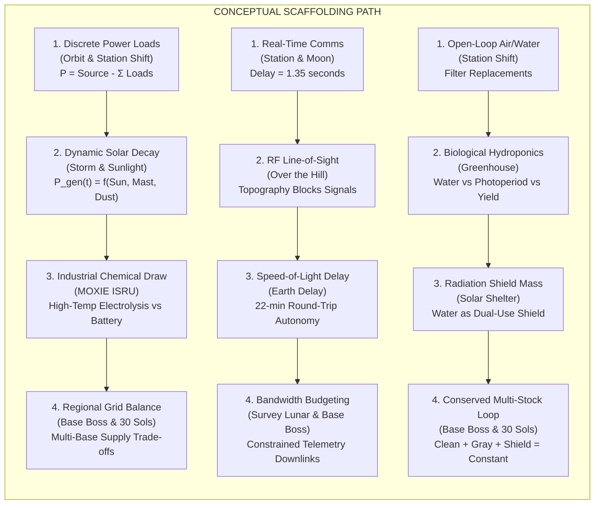
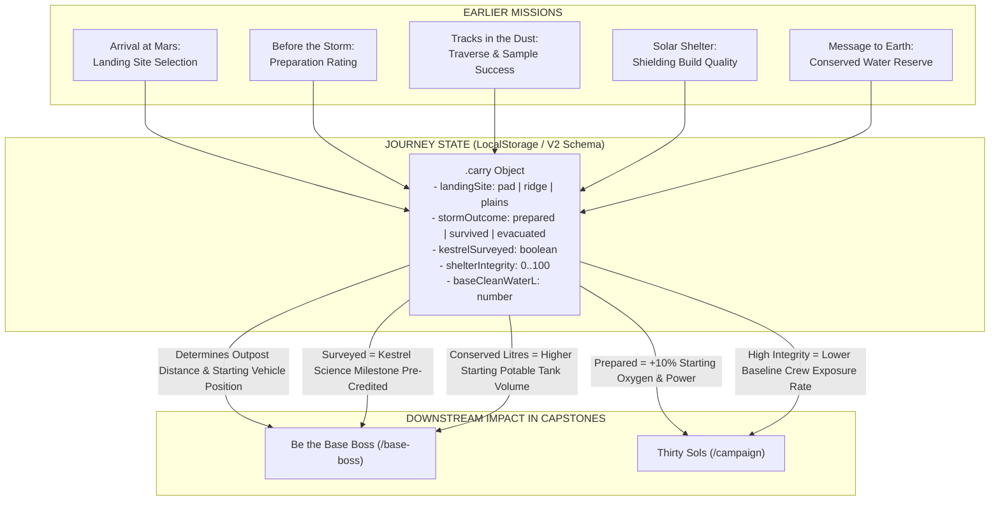
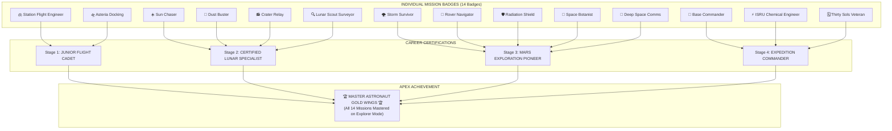

# Deliverable E: Game Progression Architecture
**Junior Astronaut Mission Trainer**
*Author: Mission Design Specialist*
*Document Reference: AGY-JAMT-DELIV-E*
*Target Platforms: Static Web / Vite / Three.js / ES Modules*
*Target Age Tiers: Cadet (Ages 7–9) & Explorer (Ages 10–12+)*

---

## Executive Overview: The Astronaut Career System

The **Astronaut Career System** provides a pedagogically rigorous, scientifically grounded progression architecture that guides players from basic orbital flight engineering to the command of complex planetary expedition networks. 

Rather than treating missions as disjointed mini-games, the architecture establishes a continuous **Astronaut Journey** structured around four escalating developmental stages:
1. **Stage 1: Cadet Orbital Training** (Low Earth & Mars Orbit)
2. **Stage 2: Lunar Surface Operations** (Horizon Outpost, Lunar South Pole)
3. **Stage 3: Mars Planetary Operations** (Meridian Outpost, Jezero Basin)
4. **Stage 4: Expedition Command & Advanced Logistics** (Meridian Basin Network)

```mermaid
flowchart TD
    subgraph Stage1["STAGE 1: Cadet Orbital Training"]
        S01["Station Shift (/station-shift)\n[Human Physiology & ECLSS]"]
        S02["Arrival at Mars (/orbit)\n[Orbital Power & Landing Hazards]"]
    end

    subgraph Stage2["STAGE 2: Lunar Surface Operations"]
        L01["Chasing the Sun (/lunar-sunlight)\n[Polar Shadows & High Masts]"]
        L02["Dust Busters (/lunar-dust)\n[Regolith Abrasiveness & Airlocks]"]
        L03["Over the Hill (/lunar-relay)\n[RF Line-of-Sight & Core Custody]"]
        L04["Survey Before You Land (/survey-lunar)\n[Robotic Precursor Hazard Scouting]"]
    end

    subgraph Stage3["STAGE 3: Mars Planetary Operations"]
        M01["Before the Storm (/storm)\n[Atmospheric Dust & Solar Decay]"]
        M02["Tracks in the Dust (/rover)\n[Terramechanics & Return Reserves]"]
        M03["A Place to Hide (/solar-shelter)\n[Space Weather & Radiation Shielding]"]
        M04["The Greenhouse Promise (/greenhouse)\n[Photobiology & Hydroponic Loops]"]
        M05["Message to Earth (/earth-delay)\n[Light-Speed Latency & Autonomy]"]
    end

    subgraph Stage4["STAGE 4: Expedition Command & Capstone"]
        C01["Be the Base Boss (/base-boss)\n[Multi-Outpost Supply Logistics]"]
        C02["Oxygen on Short Power Budget (/moxie-oxygen)\n[Industrial ISRU Chemical Synthesis]"]
        C03["Thirty Sols (/campaign)\n[Long-Duration Compound Risk Management]"]
    end

    Stage1 -->|Certification: Junior Flight Cadet| Stage2
    Stage2 -->|Certification: Lunar Field Specialist| Stage3
    Stage3 -->|Certification: Mars Exploration Pioneer| Stage4
    Stage4 -->|Award: Master Astronaut Wings| Apex["EXPEDITION COMMANDER"]

    style Stage1 fill:#1e293b,stroke:#38bdf8,stroke-width:2px,color:#fff
    style Stage2 fill:#1e293b,stroke:#94a3b8,stroke-width:2px,color:#fff
    style Stage3 fill:#1e293b,stroke:#f97316,stroke-width:2px,color:#fff
    style Stage4 fill:#1e293b,stroke:#eab308,stroke-width:2px,color:#fff
    style Apex fill:#7c2d12,stroke:#fde047,stroke-width:3px,color:#fff
```



The system is engineered with strict cognitive scaffolding: each stage introduces fundamental physical principles in controlled isolation before demanding that players synthesize multiple competing systems in subsequent stages.

---

## 1. Stage Definitions & Curriculum Pipeline

### Stage 1: Cadet Orbital Training
*The Fundamentals of Microgravity, Power Conservation, and Routine Human Survival*
- **Operating Environment:** Low Earth Orbit (ISS analogue) and Low Mars Orbit (*Asteria* Transfer Complex).
- **Core Themes:** Microgravity physical deconditioning; orbital day/night cycles; basic electrical power arithmetic ($P_{\text{net}} = P_{\text{source}} - \sum P_{\text{loads}}$); safe hardware servicing via circuit de-energization.
- **Included Missions:**
  1. `station-shift` · **Station Shift** (Introductory, Orbital ECLSS & Circadian Scheduling)
  2. `orbit` · **Arrival at Mars** (Introductory, Power Balancing, Bus Isolation & Landing Ellipses)
- **Pedagogical Function:** Low stakes, zero terrain hazards, and no environmental dust. Players learn the vital habits of space engineering: reading gauges, isolating power before touching hardware, and balancing human rest against machine maintenance.

### Stage 2: Lunar Surface Operations
*Airless Planetary Surfaces, Polar Solar Dynamics, and Immediate Direct Communication*
- **Operating Environment:** Horizon Outpost, Moon's South Pole (Shackleton / Malapert Region).
- **Core Themes:** High-contrast vacuum environment; extreme solar grazing angles ($1.5^\circ$ elevation) producing elongated topography shadows; sharp, unweathered abrasive regolith; line-of-sight radio propagation over ridges; near-instantaneous Earth contact ($1.35\text{ s}$ light-time).
- **Included Missions:**
  3. `lunar-sunlight` · **Chasing the Sun** (Introductory, Polar Illumination, Mast Winching, Cable Deployment)
  4. `lunar-dust` · **Dust Busters** (Introductory, Regolith Tribology, Airlock Interlocks, Electrodynamics)
  5. `lunar-relay` · **Over the Hill** (Intermediate, Topographic RF Obstruction, Deployable Repeaters, Drilling)
  6. `survey-lunar` · **Survey Before You Land** (Intermediate, Autonomous Precursor Scouting, Slope Certification, Bandwidth Prioritization)
- **Pedagogical Function:** Introduces planetary surface friction and physical topography while keeping communications latency near zero. Players master the environmental realities of lunar living without the added cognitive load of multi-minute communications delays.

### Stage 3: Mars Planetary Operations
*Atmospheric Weather, Deep Space Isolation, and Biological Life Support*
- **Operating Environment:** Meridian Outpost & Jezero Basin, Mars.
- **Core Themes:** Atmospheric dust storms and photovoltaic decay; terrain slope slip and non-negotiable vehicle return reserves; space weather solar particle events (SEP) and high-hydrogen radiation shielding; biological hydroponics and closed-loop fluid systems; speed-of-light communications latency ($11\text{ minutes}$ one way) enforcing local crew autonomy.
- **Included Missions:**
  7. `storm` · **Before the Storm** (Introductory, Opportunity Solar Decay, Panel Brushing, Battery Hookup)
  8. `rover` · **Tracks in the Dust** (Intermediate, HiRISE Slope Navigation, Terramechanics, Return Reserve Invariant)
  9. `solar-shelter` · **A Place to Hide** (Intermediate, DONKI Space Weather, Polyethylene/Water Mass Shielding)
  10. `greenhouse` · **The Greenhouse Promise** (Intermediate, OSD-269 Photoperiods, Hydroponic Plumbing, Fan Anomalies)
  11. `earth-delay` · **Message to Earth** (Intermediate, Horizons Light-Time Latency, Autonomous Diagnostics, Water Recycling)
- **Pedagogical Function:** Extends operational autonomy. With Earth now 22+ round-trip light-minutes away, players can no longer rely on immediate ground control guidance. They must diagnose anomalies independently and manage multi-sol biological and environmental systems.

### Stage 4: Expedition Command & Advanced Logistics
*Multi-Node Supply Networks, Industrial ISRU, and Long-Duration Risk Compounding*
- **Operating Environment:** Meridian Basin Regional Outpost Network (Meridian Hub, Verdant Farm, Kestrel Camp).
- **Core Themes:** Inter-base vehicular logistics; strictly conserved closed-loop life support (potable, gray, and shield water); large-scale chemical In-Situ Resource Utilization (ISRU); compound interest on deferred equipment maintenance; retrospective systems failure analysis.
- **Included Missions:**
  12. `base-boss` · **Be the Base Boss** (Advanced, Regional Multi-Base Coordination, Cascading Crises, Verdant Drill)
  13. `moxie-oxygen` · **Oxygen on a Short Power Budget** (Advanced, Solid Oxide Electrolysis, Diurnal Atmospheric Density)
  14. `campaign` · **Thirty Sols** (Advanced Capstone, 30-Sol Mission Management, Seeded Risk Compounding)
- **Pedagogical Function:** The apex capstone where all prior learning converges. Players manage competing outposts, run industrial chemical synthesis plants, and experience how decisions made on Sol 5 create compounding crises on Sol 25.

---

## 2. Scientific & Skill Progression Logic (Dependencies)

The curriculum enforces a strict, intentional pedagogical dependency chain where scientific concepts are scaffolded systematically:



### Why Orbital Training Precedes Lunar Operations
1. **Isolated Variable Scaffolding:** Orbit provides a pristine physics laboratory. There is zero surface regolith, zero terrain friction, and zero atmospheric weather. Players master the core arithmetic of power generation, battery buffering, and hardware de-energization without environmental noise.
2. **Human Health Foundations:** Before landing on a planetary body, players must understand the physical toll of spaceflight. *Station Shift* teaches that astronauts are biological entities requiring daily exercise, nutrition, and sleep, establishing empathy and realistic constraints for all subsequent surface operations.

### Why Lunar Operations Precede Mars Operations
1. **The Safety of Instant Telemetry:** The Moon is only $1.35\text{ light-seconds}$ from Earth. In *Chasing the Sun* and *Dust Busters*, Earth is visible in the black sky, and communications are virtually instantaneous. This allows young learners to focus entirely on learning physical surface hazards (dust abrasion, extreme shadows, airlock cycling) without the anxiety of communication isolation.
2. **Vacuum vs Atmospheric Hazards:** Lunar hazards are purely physical: razor-sharp unweathered dust and stark geometric shadows. Mars adds the complex dynamics of atmosphere: aerodynamic drag, dust devils, global dust storms that darken the sky for weeks, and variable atmospheric pressure. Mastering the Moon first prevents cognitive overload.

### Why Mars Planetary Operations Precede Expedition Command
1. **Component Mastery Before System Integration:** In Stage 3, each major outpost life-support system is examined in its own dedicated mission:
   - *Before the Storm* isolates photovoltaic power.
   - *Tracks in the Dust* isolates rover mobility and return energy.
   - *A Place to Hide* isolates radiation biophysics.
   - *The Greenhouse Promise* isolates agricultural photobiology.
   - *Message to Earth* isolates fluid recycling and latency.
2. **Scaffolding into Complexity:** Attempting to play *Be the Base Boss* without first understanding how a water recycler works or how dust reduces solar power would result in blind button-mashing. By the time a player reaches Stage 4, every subsystem in the regional dashboard is a familiar friend whose internal mechanics they have physically repaired.

---

## 3. Prerequisite Competency Framework

The Astronaut Career System evaluates progress across ten granular, measurable **Competency Domains**:

| Competency ID | Domain Name | Core Engineering Principle | Verified In Missions |
|---|---|---|---|
| **COMP-01** | **Electrical Bus Balancing** | $\sum P_{\text{loads}} \le P_{\text{source}} + P_{\text{battery}}$; de-energizing circuits before servicing hardware. | Station Shift, Arrival at Mars, Before the Storm |
| **COMP-02** | **Solar Geometry & Shadows** | Solar elevation angles, topographic shadowing, mast clearance elevation $H \ge d \cdot \tan(\theta)$. | Chasing the Sun, Arrival at Mars |
| **COMP-03** | **Regolith Tribology & Seals** | Space weathering abrasion, electrodynamic repulsion, HEPA filtration, airlock pressure boundary interlocks. | Dust Busters |
| **COMP-04** | **RF Line-of-Sight & Relays** | Raycast propagation over obstacles, repeater mast placement, multi-hop radio links. | Over the Hill, Survey Before You Land |
| **COMP-05** | **Mobility & Return Reserves** | Terramechanics slip, slope-dependent energy drain ($\text{Wh/m}$), non-negotiable return reserve invariant ($E_{\text{reserve}} \ge 20\%$). | Tracks in the Dust, Over the Hill |
| **COMP-06** | **Radiation Mass Shielding** | Ionizing radiation attenuation, hydrogen mass fraction (water/polyethylene), geometric solid-angle coverage. | A Place to Hide, Base Boss |
| **COMP-07** | **Closed-Loop Agriculture** | Controlled photoperiods (16:8), root-zone moisture metrics, fan ventilation boundaries, fresh nutrient mass. | The Greenhouse Promise, Base Boss |
| **COMP-08** | **Interplanetary Latency** | Speed-of-light delays ($OWLT = D/c$), autonomous diagnostic testing, risk-weighted decision analysis under delay. | Message to Earth, Base Boss |
| **COMP-09** | **Robotic Scouting & Survey** | Lidar micro-topography slope analysis ($< 10^\circ$), landing footprint hazard avoidance, telemetry compression. | Survey Before You Land |
| **COMP-10** | **ISRU Chemical Synthesis** | Solid oxide electrolysis ($CO_2 \rightarrow O_2$), high-temperature preheating, diurnal atmospheric density optimization. | Oxygen on Short Power, Thirty Sols |

### Competency Unlock Graph
```
COMP-01 (Power) ──────────────┬───> COMP-02 (Solar Shadows) ───> COMP-10 (ISRU Synthesis)
                             │
COMP-03 (Dust & Airlocks) ───┼───> COMP-05 (Mobility/Reserves) ─> COMP-09 (Precursor Scouting)
                             │
COMP-04 (RF Relays) ─────────┴───> COMP-08 (Comms Latency) ────┐
                                                                │
COMP-06 (Radiation Shielding) ───> COMP-07 (Crop Loops) ───────┴─> APEX: Systems Thinking
                                                                   (COMP-01 through COMP-10)
```

---

## 4. Knowledge Reuse & Cross-Mission Mechanics Transfer

The curriculum deliberately reuses mechanical patterns and simulation engines, evolving them from simple introductory forms into complex operational tools:

### 1. The Power Bus Architecture
- **In Stage 1 (*Arrival at Mars*):** Power is introduced as a clean, integer load-shedding puzzle ($10\text{ units in sun}, 6\text{ in shadow}$). Players learn that turning on the lander charger requires switching off science cameras or heaters.
- **In Stage 2 (*Chasing the Sun*):** Power becomes continuous and spatial: raising the physical mast in Three.js clears terrain shadows and generates kilowatts ($3.6\text{ kW}$) to charge the battery.
- **In Stage 3 (*Before the Storm*):** Power becomes time-dependent and meteorological: the Opportunity 2018 decay curve drains solar output over time, requiring players to integrate auxiliary batteries.
- **In Stage 4 (*Oxygen on a Short Power Budget* & *Base Boss*):** Power becomes an industrial trade-off where massive $3.0\text{ kW}$ chemical plants compete with habitat life support across an entire planetary basin.

### 2. Telecommunications & Latency
- **In Stage 1 & 2 (*Arrival at Mars* & *Over the Hill*):** Communications are instantaneous, but subject to line-of-sight blockage. Players learn that hills and ridges physically sever radio contact unless a relay is erected on the summit.
- **In Stage 3 (*Message to Earth*):** The communication problem transforms from *geometry* into *time*: the speed of light imposes a real $22\text{-minute}$ round trip, forcing the player to choose between local autonomy and waiting.
- **In Stage 4 (*Base Boss* & *Survey Lunar*):** Latency and bandwidth combine: players must manage regional communications delays while budgeting finite megabytes of downlink data.

### 3. Life Support & Water Mass Conservation
- **In Stage 2 (*Dust Busters*):** Life support is an airlock interlock: scrub the air and change the HEPA filter before opening the habitat door.
- **In Stage 3 (*The Greenhouse Promise* & *A Place to Hide*):** Water is introduced as a multi-use substance: it irrigates crops in the greenhouse and acts as mass shielding against radiation in the shelter.
- **In Stage 4 (*Base Boss*):** Water becomes a strictly conserved multi-stock closed loop:
  $$W_{\text{potable}} + W_{\text{gray}} + W_{\text{shield}} + W_{\text{crops}} = \text{Constant}$$
  Diverting water into the shelter walls directly starves the greenhouse crops, making the physical mass balance immediate and tangible.

---

## 5. Difficulty Progression: Cadet vs Explorer Tiers

The game features two comprehensive, system-wide difficulty profiles defined in `simulation/difficulty.js`. Every mission dynamically tunes its simulation parameters, UI presentation, and margin of error based on the active player tier:

| Pedagogical Dimension | Cadet Tier (Ages 7–9) | Explorer Tier (Ages 10–12+) |
|---|---|---|
| **Target Cognitive Load** | Max 2–3 simultaneous variables; clear visual hierarchy. | 5–7 interacting variables; full system interdependence. |
| **Data Presentation** | Qualitative color bands (Green/Yellow/Red); simplified points ($0–100$). | Authentic SI units ($\text{Watts}, \text{kWh}, \text{Litres}, \mu\text{Gy/h}, \text{degrees}, \text{kPa}, \text{kbps}$). |
| **Temporal Pressure** | Extended countdown clocks ($+50\%$ warning time); slow leak/drain rates. | Authentic time compression; rapid-onset emergencies. |
| **Safety Margins** | Generous buffers ($+20\%\text{ to }+50\%$ battery/oxygen reserves). | Razor-thin engineering tolerances ($10\%\text{ margin required}$). |
| **Physical Interaction** | Forgiving hold-times ($0.8\text{ s}$ to $1.2\text{ s}$); highlighted snap targets. | Precise hold-times ($1.4\text{ s}$ to $1.8\text{ s}$); manual alignment required. |
| **Diagnostic Assistance** | Pip the Robot gives direct, actionable step-by-step guidance. | Pip provides conceptual hints; player must diagnose root causes. |
| **Failure States** | "Safe Stop": player safely pauses, learns the issue, and restarts. | Cascading brownouts, component blowouts, mission aborts. |
| **Debrief & Assessment** | "Did it work?" qualitative success feedback with smiley indicators. | Quantitative efficiency graphs, telemetry traces, and trade-off comparisons. |

### Mission-by-Mission Tuning Parameters

```json
{
  "cadet_overrides": {
    "station-shift": { "shiftHours": 12, "exerciseRequiredHours": 1.5, "powerMargin": 0.40 },
    "orbit": { "dockingAssist": true, "shadowMinutes": 25, "landerStartCharge": 60 },
    "storm": { "prepSeconds": 540, "stormDrainScale": 0.60, "brushCleanMultiplier": 1.5 },
    "rover": { "drainScale": 0.65, "slipTolerated": 0.40, "autoBrake": true },
    "solar-shelter": { "onsetMinute": 90, "maxAllowedDose": 50, "carrySpeedMultiplier": 1.3 },
    "greenhouse": { "batteryKWh": 1.5, "leakLPerDay": 4.0, "moistureBand": [0.8, 3.6] },
    "earth-delay": { "waterStartL": 26, "earthThinkSeconds": 240, "consumptionRateLPerMin": 0.3 },
    "lunar-sunlight": { "suitMinutes": 150, "batteryKWh": 55, "batteryStartKWh": 35 },
    "lunar-dust": { "powerUnits": 70, "spareFilters": 2, "maxAllowedBaseDust": 30 },
    "lunar-relay": { "suitMinutes": 110, "batteryStart": 95, "autoAimRelay": true },
    "survey-lunar": { "bandwidthBudgetMB": 25, "maxAllowableSlope": 12.0, "boulderDetectionRadius": 1.5 },
    "base-boss": { "regionalDrainScale": 0.70, "cropWaterNeedLPerSol": 3.0, "drillGuidance": true },
    "moxie-oxygen": { "catalystPreheatSeconds": 30, "productionYieldBonus": 1.25, "powerDrawKW": 2.0 },
    "campaign": { "macroResourceGrouping": true, "startingRes": 80, "eventSeverityScale": 0.70 }
  }
}
```

---

## 6. Consequence Tracking & Career Decision Influences

To create a cohesive, living astronaut career, decisions made in earlier chapters leave physical and operational footprints in subsequent missions via the **Mission Carry Pipeline** managed by `journey-state.js`.



### Specific Cross-Mission Carry Mechanics

1. **Touchdown Site Carry (*Arrival at Mars* $\rightarrow$ *Before the Storm* & *Base Boss*):**
   - Selecting *Meridian Pad* lands the player right at the outpost hub; rover transit distance in *Base Boss* begins at $0\text{ km}$.
   - Selecting *Wide Plains* lands the crew on ultra-smooth terrain ($100\%$ safe), but awards the carry flag `distant_landing: true`, requiring an initial $9\text{ km}$ transit leg in *Base Boss* and increasing initial rover odometer wear.

2. **Storm Preparation Carry (*Before the Storm* $\rightarrow$ *Thirty Sols*):**
   - Achieving the *Fully Prepared* outcome writes `stormOutcome: 'prepared'` into the carry archive.
   - When launching *Thirty Sols*, the habitat begins with $80\%$ starting oxygen (instead of $75\%$) and a pre-installed auxiliary battery on the emergency bus.
   - If the player achieved only *Evacuated*, the campaign starts with $65\%$ oxygen and blown fuses on the exterior research rack.

3. **Geological Custody Carry (*Tracks in the Dust* $\rightarrow$ *Base Boss*):**
   - Successfully retrieving the rock core from Kestrel Ridge writes `kestrelSurveyed: true`.
   - In *Base Boss*, the Kestrel Camp scientific survey quest is automatically pre-cleared, granting the player immediate regional communication relay rights without having to re-drive the hazardous canyon wash.

4. **Radiation Refuge Integrity (*Solar Shelter* $\rightarrow$ *Thirty Sols*):**
   - Achieving a team radiation dose $\le 40\text{ points}$ writes `shelterIntegrity: 'high'`.
   - In *Thirty Sols*, when solar particle storm events fire on Sol 17, the crew suffers only $10\text{ exposure points}$ of damage instead of $30$, protecting crew morale and physical work stamina.

5. **Fluid Conservation Carry (*Message to Earth* $\rightarrow$ *Base Boss*):**
   - Conserving $> 20\text{ L}$ of clean water during the recycler pump repair writes `carriedCleanWaterL: 24`.
   - In *Base Boss*, the Verdant Outpost storage tank initializes with $+15\text{ L}$ of surplus clean water, giving the player breathing room before needing to execute the complex closed-loop drill.

### Safety Invariant: The Graceful Fallback Principle
To guarantee that the game remains accessible for classroom teaching, science fair demonstrations, and quick-play sampler modes:
- **Direct Route Independence:** Any mission can be launched directly via URL (e.g., `/base-boss` or `/campaign`) without completing prior chapters.
- **Default Baseline Guarantee:** If no save record exists in `localStorage`, the game initializes with a safe, balanced default baseline (`stormOutcome: 'survived'`, starting oxygen $75\%$, nominal water $20\text{ L}$).
- **Non-Punitive Margins:** Poor play in an earlier mission will provide tighter margins or fewer bonus perks in later missions, but will **never** render a subsequent mission mathematically unwinnable.

---

## 7. Badge & Certification System

The Badge and Certification System provides clear, visual recognition of milestone achievements, motivating learners to revisit missions to attain **Mastery**.



### Complete Badge Catalog & Mastery Criteria

| Badge ID | Title & Icon | Mission | Earned Criteria (⭐) | Mastered Criteria (🏆) |
|---|---|---|---|---|
| `orbit` | **Asteria Docking** 🛸 | Arrival at Mars | Dock safely and restore radio link. | Zero electrical faults; lander charged $\ge 80\%$; pad touchdown. |
| `storm` | **Storm Survivor** 🌪️ | Before the Storm | Seal shelter before dust front arrives. | All 4 panels cleaned; rover battery installed; air $\ge 85\%$. |
| `rover` | **Rover Navigator** 🚙 | Tracks in the Dust | Complete traverse and return to base. | Zero slip violations; return battery $\ge 25\%$; bonus core collected. |
| `solar-shelter` | **Radiation Shield** 🛡️ | A Place to Hide | Shelter all 4 crew members. | Team average dose $\le 40\text{ points}$; air ducts $100\%$ clear. |
| `greenhouse` | **Space Botanist** 🥗 | The Greenhouse Promise | Harvest at least 4 portions of food. | Harvest $\ge 6\text{ salad portions} + \text{ripe chile peppers}$. |
| `earth-delay` | **Deep Space Comms** 📡 | Message to Earth | Fix recycler without emergency water. | Correct diagnosis on first attempt; $\ge 20\text{ L}$ clean water preserved. |
| `lunar-sunlight` | **Sun Chaser** ☀️ | Chasing the Sun | Power Horizon Outpost for 18 days. | High Ridge Pad selected; 3-stage mast; zero cold hours. |
| `lunar-dust` | **Dust Buster** 🧹 | Dust Busters | Clean gear without base contamination. | Zero dust leaks into habitat; zero scratches on helmet visor. |
| `lunar-relay` | **Crater Relay** 📻 | Over the Hill | Retrieve core and downlink data. | 2 cores drilled; ridge relay deployed; return battery $\ge 15\%$. |
| `base-boss` | **Base Commander** 👑 | Be the Base Boss | Complete all 3 regional crises. | Verdant drill balanced; water recycling $> 95\%$; zero brownouts. |
| `campaign` | **Thirty Sols Veteran** 🗓️ | Thirty Sols | Survive 30 consecutive sols on Mars. | All 4 crew members healthy; morale $> 75\%$; all science goals met. |
| `station-shift` | **Station Flight Engineer** 🫁 | Station Shift | Complete 16-hour orbital shift. | $100\%$ exercise adherence; SAA radiation peak correctly identified. |
| `survey-lunar` | **Lunar Scout Surveyor** 🔍 | Survey Before You Land | Scout and recommend landing zone. | Site Beta certified; slope $< 5^\circ$; downlink budget fully optimized. |
| `moxie-oxygen` | **ISRU Chemical Engineer** ⚡ | Oxygen on Short Power | Produce $\ge 5\text{ kg}$ of pure oxygen. | Zero catalyst coking; diurnal density peak utilized; battery $\ge 60\%$. |

---

## 8. Technical Architecture: Carry, Persistence, & Determinism

### 1. Unified Save State Schema (`v2`)
The persistence layer in `journey-state.js` uses a clean, robust JSON schema stored under `mission-control-jr.journey.v1` (retaining the key for backward compatibility while validating internal version `2`):

```typescript
interface JourneyStateV2 {
  version: 2;
  current: string;                     // Active mission ID (e.g. 'orbit')
  selectedCampaign: 'mars' | 'moon' | 'orbital';
  campaigns: {
    orbital: { current: string };
    moon: { current: string };
    mars: { current: string };
  };
  completed: string[];                 // Array of completed mission IDs
  records: {
    [missionId: string]: {
      completed: boolean;
      success: boolean;
      mastered: boolean;
      score: number | null;
      outcome: string;                 // E.g., 'Prepared', 'Survived'
      assisted: boolean;               // True if Pip assistance was used
      carry?: Record<string, any>;     // Explicit downstream variables
      timestamp: number;
    };
  };
  attempts: {
    [missionId: string]: Array<{
      score: number;
      success: boolean;
      mastered: boolean;
      date: string;
    }>;
  };
}
```

### 2. State Sanitization & Depth Bounding
To protect young learners on shared school Chromebooks and prevent localStorage corruption:
- **`safeValue(value, depth)`:** Implements recursive type validation, capping strings at 500 characters, arrays at 50 elements, object keys at 100 entries, and recursion depth at 4 levels. Strips `__proto__`, `prototype`, and `constructor` to prevent prototype pollution.
- **`cleanRecord(record)`:** Clamps scores to $[0, 100]$, sanitizes outcome strings, and guarantees that `mastered` can only be true if `success` and `completed` are true.

### 3. Fixed-Seed Determinism for Competitions & Judging
For science fairs, classroom grading, and hackathon judging, the entire simulation engine supports deterministic execution:
- Passing `?seed=12345` in the URL fixes the pseudo-random number generator (PRNG) across all stochastic systems (dust storms, space weather onset, component failure modes, rock distribution).
- Two students executing the exact same sequence of decisions under the same seed will observe identical telemetry graphs and resource yields, enabling fair, objective competitive evaluation.

---

## Progression Architecture Summary Table

| Stage | Mission Title | Prerequisite Competencies | Downstream Carry Outputs | Target Badge |
|---|---|---|---|---|
| **Stage 1: Orbit** | **Station Shift** | None (Introductory) | Circadian Health Baseline | Station Flight Engineer 🫁 |
| **Stage 1: Orbit** | **Arrival at Mars** | COMP-01 (Power) | Landing Site Coordinates | Asteria Docking 🛸 |
| **Stage 2: Moon** | **Chasing the Sun** | COMP-01, COMP-02 (Shadows) | Power Mast Elevation Model | Sun Chaser ☀️ |
| **Stage 2: Moon** | **Dust Busters** | COMP-03 (Dust & Airlocks) | Airlock Seal Integrity | Dust Buster 🧹 |
| **Stage 2: Moon** | **Over the Hill** | COMP-04 (Relays), COMP-05 (Mobility) | Geological Core Sample Record | Crater Relay 📻 |
| **Stage 2: Moon** | **Survey Before You Land** | COMP-04, COMP-09 (Precursor Scouting)| Artemis Certified Landing Zone | Lunar Scout Surveyor 🔍 |
| **Stage 3: Mars** | **Before the Storm** | COMP-01 (Power) | Stored Energy & Oxygen Reserve | Storm Survivor 🌪️ |
| **Stage 3: Mars** | **Tracks in the Dust** | COMP-05 (Mobility & Reserves) | Kestrel Ridge Science Survey | Rover Navigator 🚙 |
| **Stage 3: Mars** | **A Place to Hide** | COMP-06 (Radiation Shielding) | Crew Radiation Dosage Factor | Radiation Shield 🛡️ |
| **Stage 3: Mars** | **The Greenhouse Promise** | COMP-07 (Crop Photobiology) | Fresh Food Dietary Supplement | Space Botanist 🥗 |
| **Stage 3: Mars** | **Message to Earth** | COMP-08 (Latency & Autonomy) | Recycler Status & Water Reserve | Deep Space Comms 📡 |
| **Stage 4: Command**| **Be the Base Boss** | COMP-01 through COMP-08 | Regional Supply Equilibrium | Base Commander 👑 |
| **Stage 4: Command**| **Oxygen on Short Power**| COMP-01, COMP-10 (ISRU Synthesis) | Manufactured Oxygen Stock | ISRU Chemical Engineer ⚡ |
| **Stage 4: Command**| **Thirty Sols** | COMP-01 through COMP-10 | Full 30-Sol Mission Record | Thirty Sols Veteran 🗓️ |

---
*End of Deliverable E: Game Progression Architecture*
